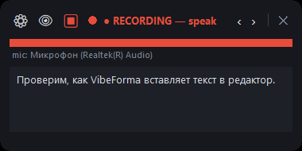

Dictation is the main loop of VibeForma: a hotkey starts listening, speech is recognized locally, and the text is inserted where the cursor was.

*The panel streams the phrase while you speak.*
## Dictate a phrase

1. Put the cursor in a text field.
2. Press `Ctrl+Alt+Space` — the default hotkey.
3. Speak.
4. End the phrase in one of three ways:
   - pause for 2 seconds of silence;
   - press the hotkey again in toggle mode;
   - release the hotkey in hold-to-talk mode.
5. The text is inserted at the cursor.

A phrase is capped at 120 seconds. When the limit is reached, recording stops and the phrase is recognized.

## Modes

| Mode | How it works | Setting |
|---|---|---|
| Toggle (default) | Press once to start, press again to stop | `hold_to_talk: false` |
| Hold to talk | Hold the hotkey while speaking, release to stop | `hold_to_talk: true` |

The mode is chosen in **Settings → Recording** and applies to the running service without a restart.

## What happens while you speak

- The microphone is captured at 16 kHz mono internally; the capture path follows the device format and resamples when needed.
- Voice activity detection (VAD) uses 512-sample frames — 32 ms each.
- Partial transcriptions are streamed to the panel about every 1.5 seconds (`partial_every_s`).
- The panel shows the microphone level and a VAD indicator, so you can see whether the app hears you.
- Start and end beeps can be enabled (`beep_on`, `beep_off`).

## Cancel a phrase

Press `Esc` while the phrase is in flight. The recording or the panel draft is discarded and nothing is inserted.

The global `Esc` listener exists only while a dictation is in flight and is destroyed afterwards, so `Esc` stays with the application you are using at all other times.

## Where the text goes

VibeForma inserts into the window that was active when you pressed the hotkey — not into whatever happens to be focused later.

If the focus changes while the phrase is being recognized, VibeForma asks:

- **Insert here** — insert into the new active window.
- **Copy** — leave the text in the clipboard.
- **Cancel** — discard it.

After 30 seconds without an answer, the text is copied. If the dialog cannot be shown, the text is copied as well. VibeForma never steals focus to show the question.

When text stays in the clipboard, a tray notification says so.

## Insertion and the clipboard

| Behavior | Detail |
|---|---|
| Paste method | `Shift+Insert` by default; `Ctrl+V` can be chosen (`paste_method`) |
| Layout independence | The default method does not depend on the keyboard layout |
| Clipboard restore | The previous clipboard is restored after about 1 second, only if `GetClipboardSequenceNumber` has not changed |
| Empty clipboard | An empty clipboard is also restored |
| Turning restore off | `restore_clipboard: false` |
| Windows clipboard history | Dictated text is marked as excluded from clipboard history and cloud clipboard on Windows 10+ |
| Third-party managers | A third-party clipboard manager may still keep the text; the settings say so |

The exclusion uses `ExcludeClipboardContentFromMonitorProcessing`, `CanIncludeInClipboardHistory=0` and `CanUploadToCloudClipboard=0`.

## Drafts on the panel

The microphone button on the panel starts a recording without the hotkey. The recognized text stays in the panel instead of being inserted immediately, and a row of actions appears below it:

- **Edit** — open the draft for correction.
- **Copy** — put it in the clipboard.
- **Insert into the selected window** — insert into the window you choose after the draft appears. A maximized window stays maximized.
- **Cancel** — discard the draft.

If no window is selected, the text goes to the clipboard. `Ctrl+Enter` inserts the panel draft.

## Undo the last insertion

Press `Ctrl+Z` within 30 seconds, in the same window where the text was inserted. VibeForma sends the undo keystroke by virtual key (`VK_Z`), so it does not depend on the keyboard layout.

After 30 seconds, or in another window, VibeForma warns that the undo is no longer allowed instead of sending a blind keystroke.

**Restore clipboard** returns the clipboard to what it was before the dictation.

## Notifications

Notifications report the number of characters — for example, "Inserted, 42 characters" — and never the dictated text. Showing the phrase is opt-in (`notify_text`).

## Language

The recognition language is fixed in the settings. VibeForma does not guess it. If the wrong language is chosen, recognition quality drops; change it in **Settings → Model & language** or from the tray.

## If dictation does not work

- No text: check the cursor, try `Shift+Insert`, check the microphone in **Settings → Recording**.
- Wrong window: see the focus-change behavior above; insertion follows the window active at the hotkey.
- Hotkey conflict: choose another combination in **Settings → Hotkeys**.
- Model missing: [Models and languages](/models/).

Full symptom index: [Troubleshooting](/troubleshooting/).

## Where to go next

- [Keyboard shortcuts](/hotkeys/) — every key the app listens to.
- [Panel, tray and autostart](/interface/) — the panel and the tray menu.
- [Dictionary](/dictionary/) — names and terms.
- [History](/history/) — optional records of dictations.
