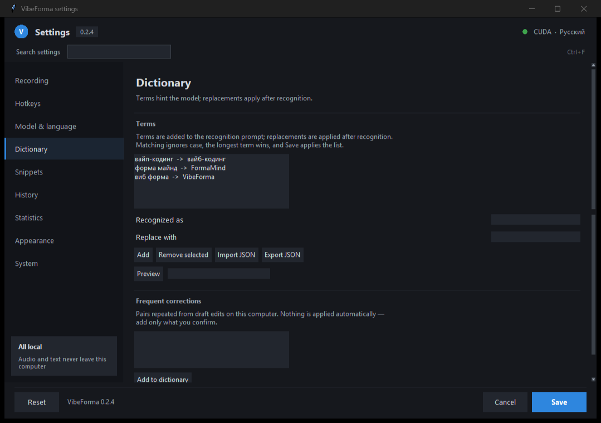

The dictionary solves two different problems:

1. **Recognition** — a term the model does not know should be heard correctly.
2. **Replacement** — a word the model heard should be written differently.

VibeForma handles them in two stages: terms go into the recognition prompt, and replacements are applied after recognition.

*Settings → Dictionary: recognition terms, replacements and the concepts map.*
## Terms and replacements

A dictionary entry is a pair: **term → replacement**.

| Term | Replacement | What happens |
|---|---|---|
| `vibe forma` | `VibeForma` | The term biases recognition; after recognition the text is rewritten to `VibeForma`. |
| `форма майнд` | `FormaMind` | The spoken Russian name becomes the product name. |
| `питон` | `Python` | A spoken word is normalized in the output. |
| `апи` | `API` | An abbreviation is written in Latin letters. |

The term is what VibeForma listens for; the replacement is what appears in the text.

## Replacement rules

| Rule | Detail |
|---|---|
| Case | Matching is case-insensitive. |
| Longest wins | When terms overlap, the longest term is replaced first. |
| One pass | Replacements run once, so a replacement cannot trigger another replacement. |
| Limit | Up to 500 pairs. |
| Import and export | JSON files. |
| Preview | Shows what a sample phrase becomes before you apply the change. |

The one-pass rule prevents loops: a pair that maps `API` to `интерфейс` and another that maps `интерфейс` back to `API` cannot bounce forever.

## Add, change, remove

1. Open **Settings → Dictionary**.
2. Add a term and its replacement.
3. Use the preview to check a sample phrase.
4. Save with `Ctrl+S`.

Entries can be edited and removed individually. Import and export move the whole dictionary as JSON, which makes a dictionary portable between machines.

## Learning from corrections

VibeForma can learn from the corrections you already make:

- A correction pair — "how it was heard → how it should be" — is collected from the panel draft, from history and from the dictionary dialog.
- When the same correction repeats — from two repetitions — the settings offer it as a hint.
- A pair enters the dictionary **only after you explicitly confirm it**.
- `corrections.json` stays on your computer. It stores only the words that changed, never the whole text.

Learning is a suggestion engine, not an automatic rewrite. Nothing is added to the dictionary silently.

## Where the dictionary is stored

The dictionary is stored with the application configuration. Export it as JSON before moving to another machine or before a clean reinstall.

The learning file `corrections.json` sits in the same folder and can be deleted at any time; the dictionary itself is not affected.

## Dictionary or snippets?

| Need | Use |
|---|---|
| Correct one word or name | Dictionary |
| Insert a whole prepared block by saying a trigger | [Snippets](/snippets/) |

A dictionary pair replaces a term inside the text. A snippet replaces a trigger with a multi-line block. They are separate pages and separate settings sections so each can grow independently.

## Limitations

- Replacements are literal text, not regular expressions.
- Matching is case-insensitive, so two entries that differ only by case cannot coexist meaningfully.
- The term must be something the model can hear; a dictionary cannot fix an inaudible phrase.
- 500 pairs is the limit; for large vocabularies, split the work between `hotwords` and snippets.

## Where to go next

- [Snippets](/snippets/) — prepared text by a spoken trigger.
- [Models and languages](/models/) — how `hotwords` reach the prompt.
- [History](/history/) — the source of correction suggestions.
- [Settings reference](/settings-reference/) — the dictionary keys.
