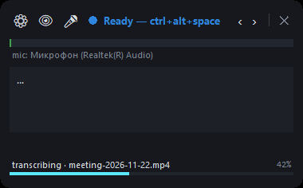
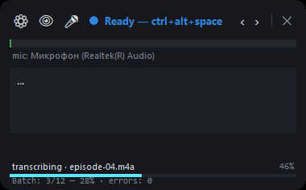

File transcription is the second input of the same recognition engine: instead of a microphone, VibeForma takes a path. It takes one file at a time or a whole folder as a batch, with a live progress strip in the panel. Everything stays on this computer — no cloud, no upload and no external `ffmpeg` binary.



*One file: the state, the file name, its percent and a real progress bar.*



*A batch: the current file on top, the counter and the overall percent underneath.*

## What can be transcribed

| Input | Formats |
|---|---|
| Video | `mp4`, `mkv`, `mov`, `webm` |
| Audio | `mp3`, `wav`, `m4a`, `m4b`, `ogg`, `flac` |

PyAV decodes the file to 16 kHz mono float32 inside the application. Recognition returns segments with a start and an end, so the result can be written as plain text or with timecodes.

## Start a file

**Tray → Transcribe file…** opens a file dialog and puts the file in the queue. A running service is required — the model must already be loaded.

A finished job offers **Open result folder**; the notification names the transcript path.

## Start a folder batch

**Tray → Transcribe folder…** asks for a folder and queues every supported file in it. Only the top level is included by default; turn on **Include subfolders** for a recursive walk (`file_folder_recursive`, also exposed as `--recursive` on the command line).

The batch rules:

- one queue and one worker: files are transcribed one at a time, never in parallel;
- an output that already exists is skipped unless **overwrite** is requested;
- two sources with the same stem cannot share one output name: the second becomes a recorded failure, and the batch continues;
- one bad file is recorded as an error, and the rest still run;
- cancel stops the current file and the whole queue.

## The queue and dictation priority

File jobs and batches share one queue with live dictation, and dictation always wins. When a dictation starts while a file is being transcribed, the job pauses between segments and resumes on the same file when the service is idle again. Cancel is cooperative: the current segment finishes, then the job stops.

The queue keeps one running job. Long files do not block the hotkey, the panel or the settings window.

## The progress strip

The panel grows a bottom strip while a file or a batch runs. It shows:

| Element | Meaning |
|---|---|
| State and file name | `queued`, `transcribing`, `paused for dictation`, `done`, `error` or `cancelled`, then the current file |
| Percent | The current file's progress against its duration |
| Bar | A moving segment while the position is unknown, a real fill once the percent is known |
| Counter | For a batch: `N/M — P%`, plus the number of failed files |

An error of one file appears in the strip while the batch goes on. A finished result stays for 8 seconds and then disappears; dictation, the hotkey and dragging the panel keep working normally.

## Long files

A file at or above 60 seconds runs through `faster_whisper.BatchedInferencePipeline` on the same loaded model, in 600-second blocks, with the same language, VAD, prompt and anti-hallucination settings. Short files and dictation stay sequential.

| Key | Default | Meaning |
|---|---|---|
| `file_batched` | `true` | Use the batched path for long files |
| `file_batch_size` | `8` | Blocks per batched pass, kept within 1–16 |

If the batched path is unavailable or fails mid-file, the job falls back to the sequential path without duplicate text. On the project's test machine a 660-second MP4 with `large-v3-turbo` on CUDA float16 ran 5.2× faster than the sequential path: 19.9 s median against 103.6 s. That number is a measurement on one machine, not a promise for every file.

The batched path is no longer an unguarded exception: every batched segment is checked against the same thresholds as the sequential path (`avg_logprob`, `no_speech_prob`, compression ratio), and a segment that fails is decoded again sequentially on its own slice of the block. A warning names the segment and the retry; the replacement passes the same post-filter. A 600-second block seam carries the last 200 characters of the previous block into the next prompt, so a name given in the first block survives the second one and the prompt does not grow.

## Quality guards

- **Invented text is dropped.** A stop list of typical false phrases in Russian and English, a `no_speech_prob` threshold of 0.6, a compression-ratio check of 1.35 on non-speech and a 2-second silence threshold remove text invented on silence and music before it reaches the transcript. A repetition loop the engine reads as speech is kept with a warning.
- **A broken word-timing block does not fail the file.** An `IndexError` from `find_alignment` in faster-whisper 1.2.1 is caught per block, the block is retried without word timestamps, the warning is logged, and already emitted segments are not repeated.
- **Per-job control.** A job can carry its own `prompt` (up to 1024 characters), `word_timestamps` and `clip_timestamps`; the applied values are reported back by `/jobs/<id>`. A range that is not numeric or runs backwards is refused with `400`.

## Subtitle cues

SRT and VTT are cut by sentences, not by the engine's 30-second window: a sentence end or a pause of 0.6 seconds closes a cue, and a seam between windows or 600-second blocks no longer splits a sentence. Without word timings the engine's own segments stand. TXT and JSON are unchanged.

## Limits

| Key | Default | Meaning |
|---|---|---|
| `file_roots` | empty | Empty allows every local fixed or removable disk; a list restricts the roots |
| `file_max_mb` | `4096` | Input file size limit |
| `file_max_s` | `21600` (6 h) | Input duration limit |
| `file_max_sync_s` | `900` (15 min) | Cap for the synchronous API; longer files go to `/jobs` |
| `job_keep_s` | `86400` (24 h) | How long a finished job stays in memory |
| `file_word_timestamps` | `false` | Add word-level timings to JSON and cut SRT/VTT by sentences |
| `file_folder_recursive` | `false` | Include subfolders in the tray folder dialog |

Network paths and UNC shares are refused: the file must live on a local disk. The full key list is on [Settings reference](/settings-reference/).

## From the command line

```powershell
.\run.cmd --transcribe "D:\audio\meeting.mp4"
.\run.cmd --transcribe-folder "D:\audio\podcast" --recursive --format srt
```

`--transcribe` prints progress to stderr and the result path to stdout; `--json` makes the answer machine-readable. `--transcribe-folder` prints a JSON summary. Both talk to the running service over the current user's named pipe and never open a port. The full contract, including exit codes 0/1/2/3/4, is on [Command line](/cli/).

## Where results land

By default each transcript is written beside its source file, with the source stem and the format extension. `--out` names another file or folder; for a batch it mirrors the folder tree under that destination. An existing output is not overwritten without `--force`.

The four formats — TXT, JSON, SRT and VTT — are described on [Transcript formats](/formats/).

## What file transcription does not do

- It does not transcribe several files in parallel: one worker, one file at a time.
- It does not translate, label speakers or burn subtitles into video.
- It does not read from a network share or a cloud drive.
- It does not require or use `ffmpeg`; decoding is internal.
- It does not rewrite punctuation: sentence punctuation comes from Whisper, and Silero is not included (ADR 0001).
- It does not record system audio: a system-audio take writes its own WAV, TXT and SRT on stop (see [Dictation](/dictation/)); this mode transcribes files and folders that already exist.

## Where to go next

- [Transcript formats](/formats/) — the four outputs and their fields.
- [Command line](/cli/) — `--transcribe`, `--transcribe-folder` and exit codes.
- [Local API](/local-api/) — files over HTTP, including the job API for long ones.
- [AI agents and integrations](/agents/) — discovery through `location.json`.
