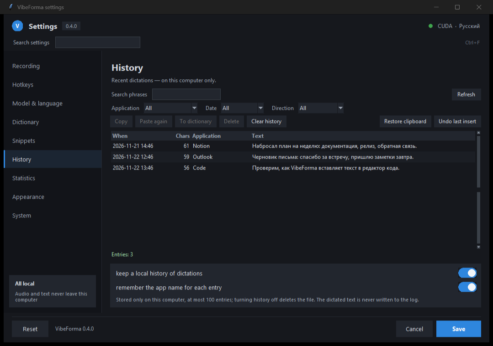

History is a local, opt-in record of your dictations. It is **off by default**. When you turn it on, VibeForma keeps the last 100 dictations in `history.jsonl` next to `config.json`.

Nothing is sent anywhere. The file stays on this computer.

*Settings → History: the last dictations, when history is enabled.*
## What is stored

Each record has these fields:

| Field | Meaning |
|---|---|
| `ts` | When the dictation happened |
| `text` | The recognized text |
| `chars` | Number of characters |
| `app` | The application that received the text |
| `way` | How it was delivered: inserted or copied |
| `audio` | The WAV file name, only when history audio is on |

Records are written atomically, so a crash does not leave a half-written line.

## Sound

`history_audio` is off by default and works only together with `history`. When both are on, VibeForma keeps a 16-bit WAV of each dictation in the `history_audio` folder next to `history.jsonl`.

- The folder is capped at 200 MiB; the oldest file goes first, and the record keeps its text while only the link to the missing sound disappears.
- Deleting a record deletes its WAV. Clearing history or dropping a record out of the 100-record ring does the same.
- Turning the option off at start deletes the sound saved by the previous run.

Audio is local like the text: it is never uploaded, synced or included in diagnostics.

## Retranscribe the last record

**Tray → Retranscribe last** asks for a prompt and decodes the WAV of the last record again. The dialog is prefilled with `hotwords`; you can also pick another model in the tray before the pass. The new text arrives in the panel draft, where you can edit, copy, insert it or cancel. The pass needs the WAV, so history audio must be on and the record must still have its sound.

## Turning history on and off

Use the switches under the history table in **Settings → History**.

Turning history **off deletes the file**. That is the intended behavior: disabling the record should remove what was recorded, not keep it quietly. Saved sound goes with it. The `history_audio` switch is not in the settings window yet; the key lives in `config.json`.

## The table

The table fills the right side of the settings window and has four columns:

| Column | Shows |
|---|---|
| When | Date and time |
| Characters | The length of the text |
| Application | Where the text went |
| Text | The recognized phrase |

The table fills the panel without scrolling the page; the rows scroll inside the table.

## Search and filters

| Control | Behavior |
|---|---|
| Search | Matches phrases in the text and the application name |
| Application filter | Narrows to one application |
| Date filter | Today, the last 7 days or the last 30 days |
| Direction filter | Inserted or copied |

Filters combine: you can look at today's copied phrases from one application.

## Selection and deletion

- Click a row to select it.
- `Ctrl+A` selects all rows.
- Select several rows with the usual extended selection.
- Delete with the button or the `Delete` key.

Deleting history records does not affect statistics. Statistics count numbers; history stores text. They are separate files and separate sections.

## Undo the last insertion

`Ctrl+Z` reverses the last insertion if all three conditions hold:

1. It is within 30 seconds.
2. It is the same window that received the text.
3. The undo has not already been used.

VibeForma sends the undo by virtual key (`VK_Z`), so it works regardless of the keyboard layout. Outside the window or after 30 seconds, the app warns instead of sending a blind keystroke.

**Restore clipboard** returns the clipboard to its state before the dictation.

## Browsing history on the panel

With history enabled, the `‹` and `›` arrows in the panel header page through saved dictations. The action row — edit, copy, insert into the selected window, cancel — works on the shown record. Pressing the dictation hotkey while the panel has focus starts a new draft and clears the history view.

## Privacy

- History is off unless you enable it.
- The file is local: `history.jsonl` next to `config.json`.
- Disabling history deletes the file.
- Dictated text is never written to the log.
- Window titles are not recorded; only the application name is stored.
- The history is not uploaded, synced or included in diagnostics.

## Limitations

- 100 records is a fixed cap; older records are dropped as new ones arrive.
- There is no export of the history table.
- History audio is off by default, has no settings switch yet, and its folder is capped at 200 MiB.
- Retranscription works on the last record only and needs that record's WAV.
- Undo is limited to the last insertion, 30 seconds, and the same window.

## Where to go next

- [Statistics](/statistics/) — counters without text.
- [Privacy](/privacy/) — what is stored and what is not.
- [Dictation](/dictation/) — insertion and undo.
- [Files and locations](/files-and-paths/) — where `history.jsonl` lives.
