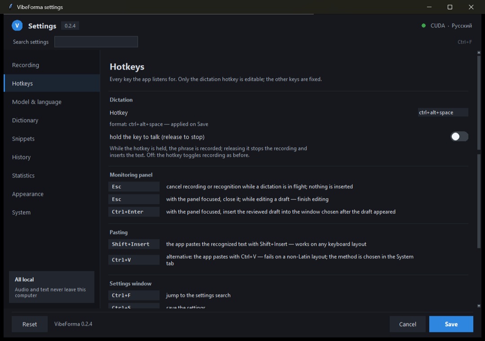

This is the complete list of keys the application listens to. Only the dictation hotkey is editable; the rest are fixed and shown here and in **Settings → Keyboard shortcuts** for reference.

*Settings → Hotkeys: the one editable hotkey and the fixed keys.*
## Global keys

| Key | Action | Editable |
|---|---|---|
| `Ctrl+Alt+Space` | Start or stop dictation. In hold-to-talk mode, hold while speaking. | Yes |
| `Esc` | Cancel the phrase in flight — recording or panel draft. Active only while a dictation is running. | No |

The default dictation hotkey can be replaced with another combination. Modifiers alone are not accepted. A combination that Windows or another application has reserved produces a warning, but the choice is not silently blocked.

## Insertion keys

| Key | Action | Notes |
|---|---|---|
| `Shift+Insert` | Paste the recognized text | Default; independent of the keyboard layout |
| `Ctrl+V` | Paste the recognized text | Alternative; chosen with `paste_method` |
| `Ctrl+Enter` | Insert the panel draft | Works when the panel has a draft |
| `Ctrl+Z` | Undo the last insertion | Within 30 seconds and in the same window; sent by the app to the target window |

`Ctrl+Z` is not a global shortcut of VibeForma. The application sends the undo keystroke to the window that received the text, using the virtual key `VK_Z`, so it works with any keyboard layout.

## Settings window

| Key | Action |
|---|---|
| `Ctrl+F` | Focus the search field |
| `Ctrl+S` | Save settings without closing the window; confirmation appears in place |
| `Esc` | Close the window |
| `Delete` | Delete the selected history rows |
| `Ctrl+A` | Select all history rows |

The **Reset** button restores default settings but keeps the model, the dictionary and the history.

## Changing the dictation hotkey

1. Open **Settings → Keyboard shortcuts**.
2. Click the hotkey field.
3. Press the new combination.
4. Save with `Ctrl+S`.

The change is protected:

- An invalid combination is not saved.
- The new listener starts before the old one stops.
- If the new listener fails, the previous combination stays and a visible notification explains what happened.

## Keys that are not global

VibeForma does not reserve `Ctrl+F`, `Ctrl+S`, `Ctrl+A`, `Ctrl+V` or `Delete` system-wide. They work only while the settings window or the history table has focus. `Esc` is global only during a dictation.

## Where to go next

- [Dictation](/dictation/) — modes and insertion behavior.
- [Settings](/settings/) — the nine sections.
- [History](/history/) — the table and its filters.
- [Panel, tray and autostart](/interface/) — the tray menu.
