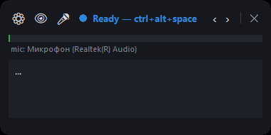
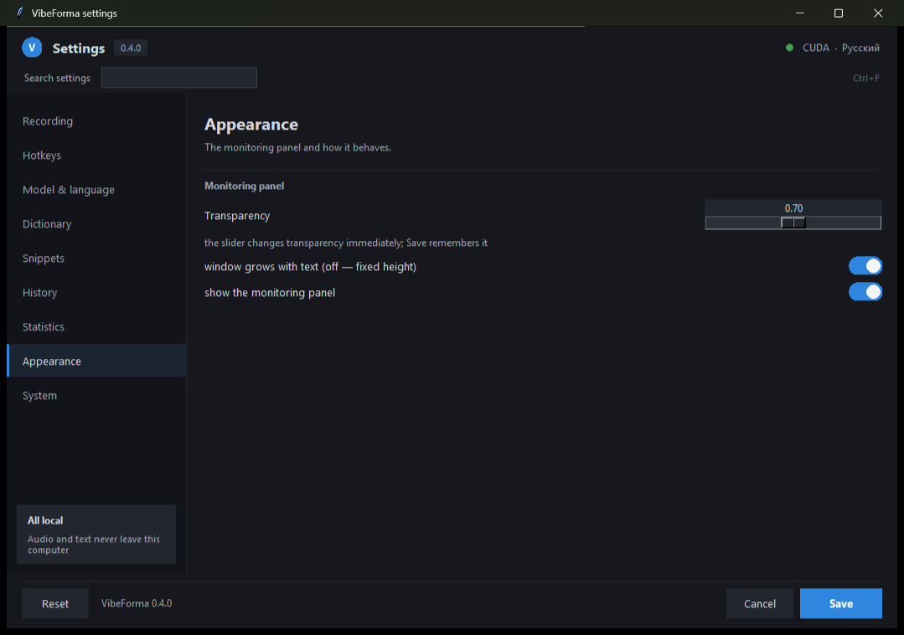

VibeForma has a small monitoring panel, a tray icon and an optional autostart entry. The panel is a convenience, not a requirement: dictation works with the panel hidden.

*The panel at rest: microphone level, state and the text area.*

*Settings → Appearance: transparency, growth and privacy.*
## The monitoring panel

The panel shows:

- the microphone level;
- a VAD indicator — whether voice activity is detected;
- the recognized text, streamed while you speak;
- the current state — idle, recording, processing, paused, error;
- the latest draft and a row of actions when a draft exists;
- doubtful words underlined in a draft, and a language hint when the pinned language looks wrong;
- the last one or two phrases as a subtitle plate during a system-audio take.

| Behavior | Detail |
|---|---|
| Transparency | `hud_alpha` |
| Automatic growth | `hud_autogrow`; the height is computed from the base on every change, so the panel does not creep up off the screen |
| Draft height | At least 6 lines when a draft appears |
| DPI | Geometry scales with the display DPI factor, so 150% scaling stays readable |
| Shape | A frameless panel clipped to a rounded region; the region is rebuilt after every resize |
| Thread | Tk runs in its own thread |
| Close | `✕` hides the panel; the tray icon stays |

## Panel actions

The microphone button starts a recording without the hotkey. The recognized text stays in the panel, and these actions appear below it:

| Action | What it does |
|---|---|
| **Edit** | Opens the draft for correction. |
| **Copy** | Puts the draft in the clipboard. |
| **Insert into the selected window** | Inserts into the window you choose after the draft appears; a maximized window stays maximized. |
| **Cancel** | Discards the draft. |
| **Recognize more precisely** | On a doubtful draft: decodes the same recording again with beam 10 at temperature 0 and replaces the draft. |
| **Restore previous** | Returns the exact text and highlighting from before the wide pass. |

Doubtful words are underlined in the draft. The two extra buttons appear only when they apply: a confident phrase gets neither, and **Restore previous** appears after a successful wide pass.

If no window is selected, the text goes to the clipboard. `Ctrl+Enter` inserts the panel draft.

With history enabled, the `‹` and `›` arrows in the panel header browse saved dictations. The same action row works on the shown record. When the panel has focus, the dictation hotkey starts a new draft and clears the history view.

## Live subtitles

With the sound source set to **System audio**, the panel shows a plate with the last one or two phrases instead of a draft. The text is not inserted anywhere; the same hotkey stops the take. A plate is capped at 400 characters and refreshes at most every 4 seconds, so the panel stays readable during a long film. On music an invented phrase may still appear: a live partial has no `no_speech_prob` or compression ratio, so only a short stop list and a repetition loop are filtered.

## Privacy mode

The eye button hides the streaming text and the last text. The microphone level stays visible, so you can still see that the app hears you. The status line disappears after 30 seconds.

`hud_privacy: true` starts the panel in privacy mode.

## The recognition overlay

While a phrase is being recognized, the panel dims and a percentage runs across it. The percentage is an animated estimate, not a measurement:

- about 90% in the first half-second;
- a ceiling of 96% until the text is ready;
- 100% only when the text is actually ready.

A thin line runs from ice to cyan, and the overlay fades when the text appears.

## The update button

When a new release is found, a blue **Update** button appears on the panel. It uses the same update path as the tray and the settings.

## The file progress strip

A file or a folder batch adds a strip at the bottom of the panel. It shows the state, the current file name, its percent, a progress bar and — for a batch — the counter `N/M — P%` with the number of failed files. The strip stays for the whole queue, shows the error of one file while the batch continues, and hides a finished result after 8 seconds.

The strip never takes the dictation overlay's place: dictation has priority and pauses a running file between segments. Details are on [File transcription](/file-transcription/).

## The tray menu

The tray icon is colored by service state. Its menu carries these items; conditional ones appear only when they apply:

1. Settings
2. Show panel
3. **Transcribe file…**
4. **Transcribe folder…**
5. Cancel batch — while a batch runs
6. Open result folder — after a finished file job
7. Setup assistant
8. Diagnostics
9. Release notes — when an update is found
10. Update to `<version>` — when an update is found
11. Update later — when an update is found
12. Pause / resume
13. Input device
14. Model
15. Recognition language
16. History
17. Retranscribe last — asks for a prompt and puts the new text in the panel draft
18. Undo last insertion
19. Logs folder
20. Exit

The tray is the way back when the panel is hidden. A second launch does not start a second copy: it asks the running instance to show the panel.

## Autostart

Autostart is created by the installer and can be toggled in **Settings → System**. It starts the service with Windows so the hotkey is available without opening anything.

## One instance

A single-instance lock (`service.lock`) prevents two services from running at once. Two services would fight over the microphone, the hotkey and the local API port.

## status.json

The service writes `status.json` on every state change. It is a convenience for scripts, not a source of truth. It contains the state, version, pid and timestamp. A status response older than 60 seconds is not trusted.

## Where to go next

- [Keyboard shortcuts](/hotkeys/) — the keys the panel and settings use.
- [Dictation](/dictation/) — the full dictation loop.
- [File transcription](/file-transcription/) — the tray actions and the progress strip.
- [Updates](/updates/) — how the update button behaves.
- [Files and locations](/files-and-paths/) — `status.json`, `service.lock` and logs.
