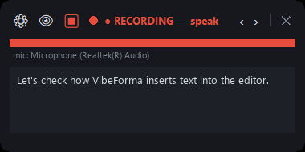

VibeForma is a local voice dictation app for Windows. Press a hotkey, speak, and the recognized text appears where the cursor is — in an editor, a browser, a chat window, or an IDE.

**From voice vibe to sharp form.**

*The panel while VibeForma records a phrase.*
## The problem it solves

Speaking is faster than typing, but most dictation services send your voice to a cloud account. VibeForma recognizes speech on your machine. The network is needed once, to download the recognition model, and later for update checks. There are no accounts and no telemetry.

## How dictation works

1. Put the cursor where the text should go.
2. Press `Ctrl+Alt+Space` — the default hotkey. In hold-to-talk mode, hold it while you speak.
3. Speak. The panel streams the recognized text while VibeForma listens.
4. Stop: press the hotkey again, release it in hold mode, or simply pause. After 2 seconds of silence the phrase ends.
5. The finished text is inserted at the cursor.

Recognition uses faster-whisper, a local implementation of the Whisper model. The recognition language is fixed: what you choose is what the model recognizes, with no automatic guessing.

## What is included

- **Dictation** in toggle or hold-to-talk mode, with voice activity detection, a 120-second phrase limit and `Esc` to cancel.
- **File transcription** of audio and video on the same local engine, including folder batches, four output formats and a progress strip in the panel.
- **A monitoring panel** with the microphone level, VAD indicator, streaming text, a privacy mode and actions for the latest draft.
- **Nine settings sections**, applied to the running service without a restart.
- **Four models** — large-v3, large-v3-turbo (default), medium and small — switchable without restarting the app, with rollback if a download fails.
- **A dictionary** for terms and replacements, and **snippets** for spoken triggers.
- **History** — off by default, the last 100 dictations when enabled — and **statistics** that store numbers, never text.
- **A panel, tray icon and autostart**, one running instance, and rotating logs.
- **A command line** (`--toggle`, `--cancel`, `--status`, `--transcribe`, `--transcribe-folder`, `--doctor`, `--selftest`) and an optional local HTTP API bound to `127.0.0.1`.
- **English and Russian** interface and documentation.

VibeForma is free and open source under the MIT license.

## What it does not do

VibeForma 0.5.4 is a local dictation and file transcription tool, not a meeting or media platform:

- It runs on Windows only.
- It does not detect the language automatically; you choose it.
- It transcribes files one at a time, not several in parallel.
- It does not summarize meetings, label speakers, translate or burn subtitles into video.
- It has no cloud, accounts, teams or billing.

The full list is on [Known issues and limitations](/known-issues/).

## Where to go next

- [Quickstart](/quickstart/) — install and dictate your first phrase.
- [VibeForma and alternatives](/comparison/) — how it compares with other dictation and transcription tools.
- [Dictation](/dictation/) — modes, insertion and the panel.
- [Privacy](/privacy/) — what stays on your machine and when the network is used.
- [VibeForma in FormaMind](/formamind/) — how the app works as the voice layer of a project tool.
