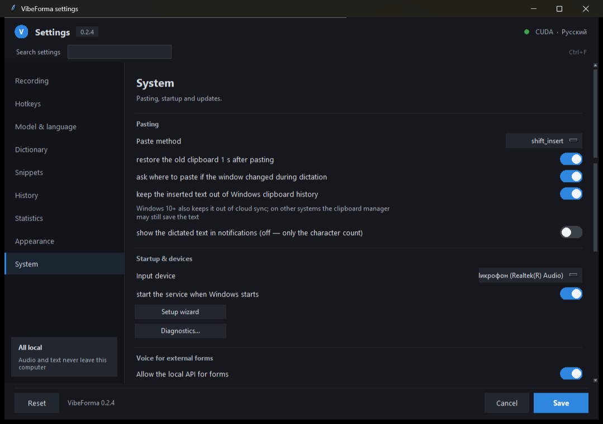

VibeForma can expose a small HTTP API for local tools. It is **off by default**. When enabled, it listens only on `127.0.0.1` and requires a token.

This is the technical bridge for editors, scripts and agents — the surface FormaMind can use without a cloud account.



*Settings → System: the local API switch.*
## Enable the API

1. Open **Settings → System**.
2. Turn on the local API.
3. VibeForma creates and saves the API token automatically on the first enable.
4. The listener starts on the live service without a restart.

If the token is missing, the server does not start. The failure is fail-closed: no token, no listener.

## Address and port

| Item | Value |
|---|---|
| Bind address | `127.0.0.1` only |
| Default port | `8787` |
| Busy port | A free loopback port is taken automatically |
| Discovery | `location.json` publishes the actual port |
| Reachable from another machine | No |

Tools should read `location.json` instead of assuming 8787:

```json
{
  "schema": 1,
  "app": "VibeForma",
  "version": "0.2.4",
  "config": "C:\\Users\\you\\AppData\\Local\\VibeForma\\config.json",
  "api": "on",
  "port": 8787
}
```

The file contains no secret. The token stays in `config.json`.

## Authentication

Every request must carry the token:

```
X-VibeForma-Token: <token>
```

The comparison is constant-time (`hmac.compare_digest`). A missing or wrong token returns `401`.

Read the token from `config.json` in your client; never hard-code it into a shared script or commit it.

## Endpoints

### `GET /health`

Reports the service state:

| Field | Meaning |
|---|---|
| `ok` | Whether the service is healthy |
| `app` | Application name |
| `api` | API state |
| `port` | Actual listening port |
| `version` | Product version |
| `model` | Loaded model |
| `language` | Recognition language |
| `state` | idle, recording, processing, paused, updating, error |

### `POST /transcribe`

Transcribes one short WAV recording.

| Requirement | Value |
|---|---|
| Method and path | `POST /transcribe` |
| Header | `X-VibeForma-Token` |
| Content type | `audio/wav` |
| Body | WAV bytes |
| Maximum size | 10 MB |
| Rate | At most one request per second |
| Service state | Only while the service is free; a dictation has priority |

On success the response carries the recognized text as JSON. A temporary WAV named `_http_in_*.wav` is created in the logs folder and deleted on any outcome.

## Status codes

| Code | When |
|---|---|
| `200` | The request succeeded |
| `401` | The token is missing or wrong |
| `404` | Unknown path |
| `409` | The service is busy — for example, a dictation is running |
| `411` | `Content-Length` is missing |
| `413` | The body is larger than 10 MB |
| `415` | `Content-Type` is not `audio/wav` |
| `429` | More than one request per second |

A rejected request is read up to 1 MB and then answered, so the client receives the status code instead of a connection reset.

## Examples

### PowerShell

```powershell
$config = Get-Content "$env:LOCALAPPDATA\VibeForma\config.json" | ConvertFrom-Json
$token = $config.http_token

Invoke-RestMethod -Uri "http://127.0.0.1:8787/health" `
  -Headers @{ "X-VibeForma-Token" = $token }

Invoke-RestMethod -Uri "http://127.0.0.1:8787/transcribe" `
  -Method Post `
  -Headers @{ "X-VibeForma-Token" = $token } `
  -ContentType "audio/wav" `
  -InFile "C:\audio\phrase.wav"
```

### curl

```bash
curl -s http://127.0.0.1:8787/health \
  -H "X-VibeForma-Token: $VIBEFORMA_TOKEN"

curl -s -X POST http://127.0.0.1:8787/transcribe \
  -H "X-VibeForma-Token: $VIBEFORMA_TOKEN" \
  -H "Content-Type: audio/wav" \
  --data-binary @phrase.wav
```

## What the API does not do

- It does not accept audio from another machine.
- It does not transcribe long files. The 10 MB WAV limit and the one-request-per-second rate are dictation limits; file transcription is planned for 0.3.0.
- It does not expose settings, history or the dictionary.
- It does not use TLS, because the traffic never leaves the loopback interface.

## Security notes

- The listener is loopback-only; a remote client cannot reach it.
- The token is required on every request and compared in constant time.
- The rate limit and the busy answer prevent the API from competing with live dictation.
- Temporary audio is deleted on every outcome.
- The token is in `config.json`; redact it before sharing logs or the file.

More on [Security](/security/).

## If a request fails

| Symptom | Check |
|---|---|
| Connection refused | The API is off, or the service is not running |
| `401` | The token in the request does not match `config.json` |
| `404` | The path is `/health` or `/transcribe`; nothing else exists |
| `409` | The service is recording or processing; retry when idle |
| `413` | The WAV is over 10 MB; send a shorter phrase |
| `415` | Set `Content-Type: audio/wav` |
| `429` | Wait at least one second between requests |

## Where to go next

- [Command line](/cli/) — the hook and the flags.
- [Security](/security/) — the threat model and reporting.
- [Files and locations](/files-and-paths/) — `location.json` and `config.json`.
- [VibeForma in FormaMind](/formamind/) — the integration this API serves.
