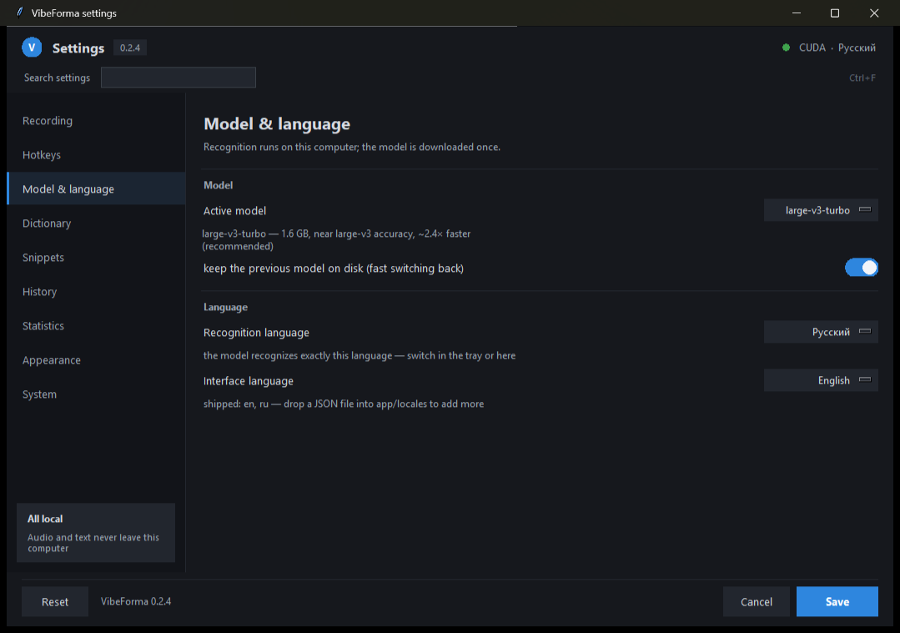

VibeForma keeps one model loaded for the lifetime of the service. You choose the model and the recognition language; the app does not guess either.

*Settings → Model & language: one active model and the exact recognition language.*
## The four models

| Model | Approximate size | Role |
|---|---|---|
| `large-v3` | 3.1 GB | The highest quality of the four; the slowest. |
| `large-v3-turbo` | 1.6 GB | The default. Much faster than large-v3, with slightly weaker punctuation. |
| `medium` | 1.5 GB | A middle option for weaker machines. |
| `small` | 0.5 GB | The smallest; the installer suggests it on a CPU-only machine. |

The README benchmark — a 12.5-second phrase, CUDA float16, best of three — is 1.53 s for `large-v3` and 0.64 s for `large-v3-turbo`, about 2.4 times faster. Those are the only published timings; do not expect the same numbers on other hardware.

## How to choose

- **Start with `large-v3-turbo`.** It is the default for a reason: near-large quality at a fraction of the time.
- **Choose `large-v3`** when accuracy matters more than latency and the machine can carry 3.1 GB.
- **Choose `medium` or `small`** when memory, disk or CPU is limited, or when you dictate short phrases and want the lowest latency.
- **On a CPU-only machine**, `small` is the sane starting point; the installer picks it for unattended CPU installs.

Quality also depends on the microphone, the room and the language. A larger model does not fix a bad input signal.

## Switching a model

The model can be changed in **Settings → Model & language** or from the tray. No restart is required.

The switch runs through four phases:

1. **download** — fetch the model if it is not on disk;
2. **load** — load it into the service;
3. **remove** — remove the old model if you chose not to keep it;
4. **done**.

If the download or load fails, the previous model is restored. If a dictation is running, the switch answers "busy" instead of interrupting it.

`model_keep_old` controls whether the previous model stays on disk. Keeping it makes switching back fast at the cost of disk space. When the option is off, only a downloaded model inside `models\` can be removed: an absolute path, a `..` step, another drive or a link leading outside is refused, so a folder you added is never a deletion target.

## Model updates

Since 0.5.5 a background check every 24 hours (`model_update_interval_h`, `model_update_check` turns it off) compares your downloaded catalog models with Hugging Face. When a newer revision exists, **Settings → Model & language** offers it with **Update** and **Not now** buttons and one tray notification; a manual **Check model updates** button runs the check on demand. A declined revision is not offered again, even after a restart.

The update runs only on your click, one model at a time, and only while the service is idle with no file queue — otherwise a clear "wait for the current cycle" refusal. The new revision is downloaded into a temporary folder, validated by the same gate any model passes, and swapped in. The previous revision is **kept on disk** as `previous-<model>-<revision>` beside the model folder: delete it to reclaim the space, or swap the folder names to go back without re-downloading. Any download, validation or load failure restores the previous folder and the working model. With no network, dictation is unaffected — the check just stays silent.

`model_folders` folders are never checked or updated. A model living only in the shared Hugging Face cache is copied into `models\` first, and the cache itself is never removed.

## Local model folders

**Settings → Model & language** keeps a list of CT2 model folders you can switch between without typing a path. Each row shows the folder's name, its path and a validity mark; the current model is marked. The buttons work like this:

| Button | What it does |
|---|---|
| **Add folder** | Opens a directory picker and refuses a folder without `model.bin` with a named error; a duplicate is not added. |
| **Use** | Switches to the folder through the same progress dialog, so a failed switch keeps the model that was in use. |
| **Remove from the list** | Deletes the record only and never a file. The current model's record stays with an explanation. |
| **Return to the built-in** | Selects a catalog model again. |

Validity is `model.bin` present, computed every time the list is drawn, so a folder that lost the file turns invalid instead of keeping a stale mark. It is a presence check, not a deep inspection: damaged weights surface when the model loads, and the model that was in use is kept.

The list lives in `config.json` as `model_folders` — `{name, path}` records, absolute paths, no duplicates, up to 20 — survives a restart, and an old config without the key reads as an empty list. A manual path in `model` keeps working beside it.

### Where a model comes from

VibeForma looks for a model in this order:

1. `models\<name>` inside the service folder;
2. the shared Hugging Face cache;
3. a fresh download.

That order makes a reinstall work offline when the model is already present. A folder saved in the local list is used from its own path as it is and is not looked up in that order.

## CUDA and CPU

| Profile | Precision | When |
|---|---|---|
| NVIDIA CUDA | float16 | An NVIDIA GPU and a working CUDA setup are found |
| CPU | int8 | No usable CUDA, or `-Cpu` was passed |

CUDA wheels are installed only for the CUDA profile. If `config.json` says `cuda` but the machine has no usable CUDA, VibeForma corrects the configuration instead of failing every dictation.

## Languages

Two different numbers, often confused:

- **The model** supports about 99 languages. That is a property of Whisper.
- **The recognition menu** offers 26 language codes. That is the list VibeForma exposes.

The recognition language is exact. The model recognizes the chosen language and nothing else. This is deliberate — automatic detection on short phrases and mixed vocabulary is unreliable, and a wrong guess ruins the phrase.

Language names are shown as endonyms — English, Русский, Українська, Deutsch — each language in its own script. The code is stored in `config.json`.

Switch the language in **Settings → Model & language** or from the tray. It applies without a restart.

### Prompt presets

For every one of the 26 menu languages, VibeForma adds a language-specific prompt hint for punctuation and capitalization. Personal terms from `hotwords` always go into the initial prompt, regardless of language.

### One language at a time

VibeForma recognizes one chosen language per phrase. It does not translate, and it does not switch languages mid-phrase. For mixed speech, choose the dominant language and add the foreign terms to the dictionary or `hotwords`.

## Where to go next

- [Dictation](/dictation/) — how a phrase is captured and inserted.
- [Dictionary](/dictionary/) — terms and replacements.
- [System requirements](/requirements/) — disk and GPU facts.
- [Settings reference](/settings-reference/) — model and language keys.
