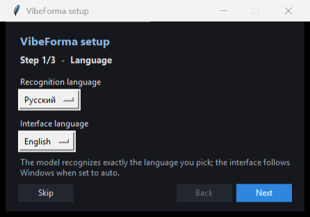

This tutorial takes you from a clean Windows machine to your first dictated sentence. It should take about ten minutes, most of it downloading a model.



*The three-step setup wizard on first launch.*
## Before you start

- Windows 10 (build 1809 or newer) or Windows 11, x64 or ARM64.
- Python 3.10–3.14 available for the installer. The installer checks this before it changes anything.
- Free disk space for the model plus about 4 GB. The default `large-v3-turbo` model is about 1.6 GB.
- A microphone. A USB headset or the built-in microphone both work.
- No administrator rights are required: VibeForma installs into `%LOCALAPPDATA%\VibeForma`.

The full table is on [System requirements](/requirements/).

## Install

Open PowerShell and run:

```powershell
irm https://raw.githubusercontent.com/FormaMindPro/vibeforma/main/install.ps1 | iex
```

The installer finds Python, downloads the latest released build, creates a virtual environment, installs dependencies, downloads the recognition model, creates shortcuts and starts the service.

To choose a model or an install directory, pass parameters:

```powershell
irm https://raw.githubusercontent.com/FormaMindPro/vibeforma/main/install.ps1 -OutFile install.ps1
.\install.ps1 -Model small -Target D:\VibeForma
```

All parameters are listed on [Installation](/installation/).

## First run

On the first start, a three-step assistant appears:

1. **Interface and recognition language.** Choose the language of the app and the language the model should recognize. The recognition language is fixed; it is not detected automatically.
2. **Microphone.** Pick an input device and watch the live level. Press **Check microphone** to record a short phrase. The recognized text is shown and is not inserted anywhere.
3. **Hotkey.** Press the combination you want to use for dictation. Modifiers alone are not accepted. **Skip** writes safe defaults.

You can reopen the assistant later from the tray menu and from the settings.

## Dictate your first phrase

1. Open any text field — Notepad, a browser, a chat window.
2. Put the cursor where the text should go.
3. Press `Ctrl+Alt+Space` and say a sentence.
4. Pause for two seconds, or press the hotkey again. The phrase ends automatically after 2 seconds of silence.
5. The text appears at the cursor.

If the panel is visible, it shows the microphone level and the text while VibeForma recognizes it.

## Check the result

- The text is inserted into the window that was active when you pressed the hotkey.
- A notification reports the number of characters, not the text itself.
- If you copied something before dictating, the previous clipboard is restored after about one second.

## Transcribe a file

1. Right-click the tray icon and choose **Transcribe file…**.
2. Pick an audio or video file — `mp4`, `mkv`, `mov`, `webm`, `mp3`, `wav`, `m4a`, `m4b`, `ogg` or `flac`.
3. Watch the strip at the bottom of the panel: state, file name and percent. Dictation keeps working and pauses the file between segments.
4. When it finishes, the notification names the transcript; **Tray → Open result folder** opens its folder.

For a whole folder, choose **Transcribe folder…**; the top level is included by default. Results land beside their sources as SRT unless another format is chosen. More on [File transcription](/file-transcription/).

## If something does not work

- No text appears: make sure the cursor is in a text field, then try `Shift+Insert`. This insertion does not depend on the keyboard layout.
- The microphone is silent: open **Settings → Recording**, choose another input device and try **Check microphone** again.
- The hotkey does nothing: another application may own the combination. Choose another one in **Settings → Hotkeys**.
- The model did not download: check the network and free disk space, then retry from the installer or **Settings → Model & language**.

More in [Troubleshooting](/troubleshooting/) and [Diagnostics and logs](/diagnostics/).

## Where to go next

- [Dictation](/dictation/) — modes, insertion and the panel.
- [Settings](/settings/) — the nine sections and what they change.
- [File transcription](/file-transcription/) — files, folder batches and the progress strip.
- [Dictionary](/dictionary/) — teach VibeForma your names and terms.
- [Keyboard shortcuts](/hotkeys/) — every key the app listens to.
