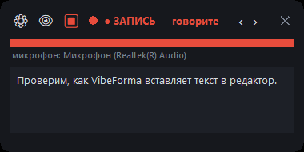

Диктовка — основной цикл VibeForma: горячая клавиша начинает запись, речь распознаётся локально, а текст вставляется туда, где стоял курсор.

*Панель показывает фразу по мере речи.*
## Продиктуйте фразу

1. Поставьте курсор в текстовое поле.
2. Нажмите `Ctrl+Alt+Space` — горячую клавишу по умолчанию.
3. Говорите.
4. Завершите фразу одним из трёх способов:
   - пауза 2 секунды тишины;
   - повторное нажатие клавиши в режиме toggle;
   - отпускание клавиши в режиме удержания.
5. Текст вставляется в позицию курсора.

Фраза ограничена 120 секундами. По достижении лимита запись останавливается, и фраза распознаётся.

## Режимы

| Режим | Как работает | Настройка |
|---|---|---|
| Toggle (по умолчанию) | Нажали — запись, нажали ещё раз — стоп | `hold_to_talk: false` |
| Удержание | Держите клавишу, пока говорите, отпускаете — стоп | `hold_to_talk: true` |

Режим выбирается в **Настройки → Запись** и применяется к работающему сервису без перезапуска.

## Что происходит, пока вы говорите

- Микрофон внутри захватывается в 16 кГц mono; путь захвата следует формату устройства и при необходимости пересчитывает частоту.
- Определение речи (VAD) использует кадры по 512 сэмплов — по 32 мс.
- Частичные транскрипции стримятся в панель примерно каждые 1,5 секунды (`partial_every_s`).
- Панель показывает уровень микрофона и индикатор VAD, поэтому видно, слышит ли вас приложение.
- Звуковые сигналы начала и конца можно включить (`beep_on`, `beep_off`).

## Отмена фразы

Нажмите `Esc`, пока фраза в полёте. Запись или черновик панели отбрасывается, ничего не вставляется.

Глобальный слушатель `Esc` существует только на время диктовки и уничтожается после, поэтому всё остальное время `Esc` остаётся приложению, в котором вы работаете.

## Куда попадает текст

VibeForma вставляет в окно, активное в момент нажатия горячей клавиши, — а не в то, что случайно оказалось в фокусе позже.

Если фокус сменился, пока фраза распознавалась, VibeForma спрашивает:

- **Вставить здесь** — вставить в новое активное окно.
- **Скопировать** — оставить текст в буфере обмена.
- **Отмена** — отбросить.

Через 30 секунд без ответа текст копируется. Если диалог показать нельзя, текст тоже копируется. VibeForma никогда не крадёт фокус, чтобы показать вопрос.

Когда текст остаётся в буфере, об этом сообщает уведомление трея.

## Вставка и буфер обмена

| Поведение | Деталь |
|---|---|
| Метод вставки | По умолчанию `Shift+Insert`; можно выбрать `Ctrl+V` (`paste_method`) |
| Независимость от раскладки | Метод по умолчанию не зависит от раскладки клавиатуры |
| Возврат буфера | Прежний буфер возвращается примерно через 1 секунду, только если `GetClipboardSequenceNumber` не изменился |
| Пустой буфер | Пустой буфер тоже восстанавливается |
| Отключение возврата | `restore_clipboard: false` |
| История буфера Windows | Продиктованный текст помечается исключённым из истории буфера и облачного буфера Windows 10+ |
| Сторонние менеджеры | Сторонний менеджер буфера всё равно может сохранить текст; в настройках есть оговорка |

Исключение использует `ExcludeClipboardContentFromMonitorProcessing`, `CanIncludeInClipboardHistory=0` и `CanUploadToCloudClipboard=0`.

## Черновики на панели

Кнопка микрофона на панели начинает запись без горячей клавиши. Распознанный текст остаётся в панели, а не вставляется сразу; под ним появляется ряд действий:

- **Корректировать** — открыть черновик для правки.
- **Копировать** — положить в буфер обмена.
- **Вставить в указанное место** — вставить в окно, которое вы выберете после появления черновика. Максимизированное окно остаётся максимизированным.
- **Отмена** — отбросить черновик.

Если окно не выбрано, текст уходит в буфер. `Ctrl+Enter` вставляет черновик панели.

## Отмена последней вставки

Нажмите `Ctrl+Z` в течение 30 секунд в том же окне, куда вставили текст. VibeForma отправляет отмену по виртуальной клавише (`VK_Z`), поэтому это не зависит от раскладки.

Через 30 секунд или в другом окне VibeForma предупреждает, что отмена больше не разрешена, вместо слепой отправки клавиши.

**Вернуть буфер** возвращает буфер обмена в состояние до диктовки.

## Уведомления

Уведомления сообщают число знаков — например, «Вставлено, 42 знака», — и никогда не показывают продиктованный текст. Показ фразы включается отдельно (`notify_text`).

## Язык

Язык распознавания фиксирован в настройках. VibeForma его не угадывает. Если выбран не тот язык, качество распознавания падает; смените его в **Настройки → Модель и язык** или из трея.

## Если диктовка не работает

- Нет текста: проверьте курсор, попробуйте `Shift+Insert`, проверьте микрофон в **Настройки → Запись**.
- Не то окно: см. поведение при смене фокуса выше; вставка следует за окном, активным при нажатии клавиши.
- Конфликт клавиши: выберите другое сочетание в **Настройки → Горячие клавиши**.
- Нет модели: [Модели и языки](/ru/models/).

Полный указатель симптомов — в разделе [Решение проблем](/ru/troubleshooting/).

## Что дальше

- [Горячие клавиши](/ru/hotkeys/) — все клавиши, которые слушает приложение.
- [Панель, трей и автозапуск](/ru/interface/) — панель и меню трея.
- [Словарь](/ru/dictionary/) — имена и термины.
- [История](/ru/history/) — необязательные записи диктовок.
