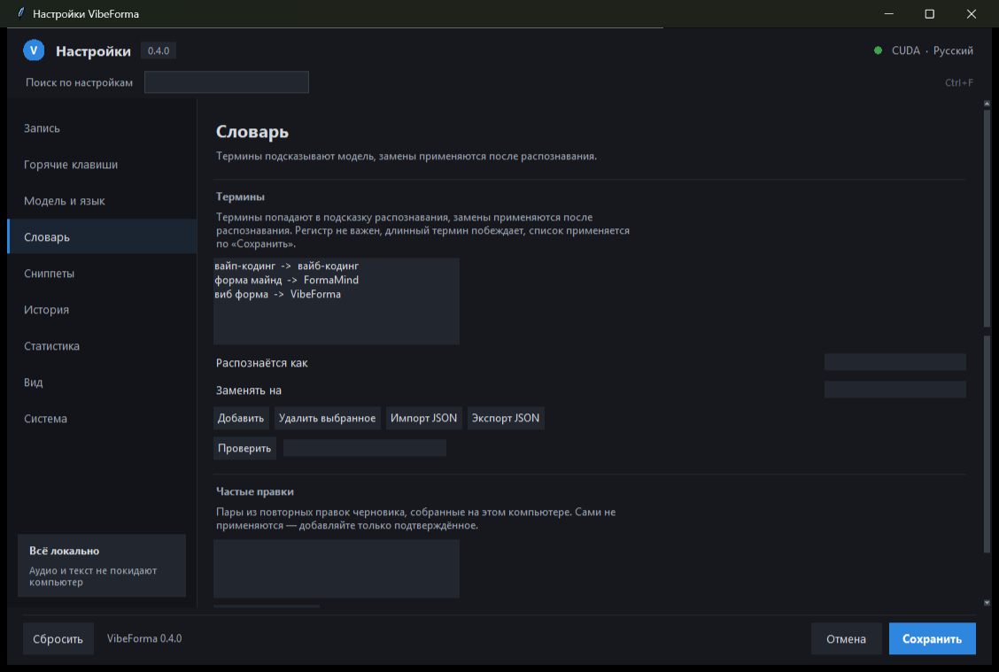

Словарь решает две разные задачи:

1. **Распознавание** — термин, которого модель не знает, должен быть услышан правильно.
2. **Замена** — слово, которое модель услышала, должно быть записано иначе.

VibeForma обрабатывает их в два этапа: термины уходят как `hotwords` в каждое 30-секундное окно распознавания, а замены применяются после распознавания.



*Настройки → Словарь: термины распознавания, замены и карта понятий.*
## Термины и замены

Запись словаря — это пара: **термин → замена**.

| Термин | Замена | Что происходит |
|---|---|---|
| `vibe forma` | `VibeForma` | Термин подсказывает распознаванию; после распознавания текст переписывается в `VibeForma`. |
| `форма майнд` | `FormaMind` | Произнесённое русское название становится именем продукта. |
| `питон` | `Python` | Произнесённое слово нормализуется в выводе. |
| `апи` | `API` | Аббревиатура записывается латиницей. |

Термин — то, что VibeForma слушает; замена — то, что появляется в тексте.

## Как термины доходят до распознавания

- Термин передаётся через параметр движка `hotwords` на каждом 30-секундном окне, поэтому слово, сказанное ближе к концу длинной записи, всё равно получает подсказку. Тот же путь обслуживает диктовку, живые частичные результаты и транскрибацию файлов.
- В качестве hotword используется **замена**, а не термин в том виде, как он набран. Пара `vibe forma → VibeForma` учит модель нужному написанию.
- До 223 токенов отбираются по частотности правок в `corrections.json`: чаще исправляемые термины идут первыми, а не влезающий термин пропускается целиком, а не режется посреди слова. Ваши собственные `hotwords` берутся раньше терминов словаря.

## Профили приложений

Профиль привязывает словарь и сниппеты к одному приложению:

```json
"app_profiles": [
  {
    "name": "Editor",
    "process": "code",
    "window": "project",
    "dictionary": [{"from": "vibe form", "to": "VibeForma"}],
    "snippets": [{"trigger": "signature", "text": "Best regards"}]
  }
]
```

- Цель — имя процесса без пути и `.exe`, фрагмент заголовка окна или оба сразу; при обоих совпадать должны оба.
- Профиль выбирается по окну, которое получит текст, а не по тому, что случайно оказалось впереди к концу фразы.
- Записи профиля лежат поверх глобальных: одно правило на термин или триггер, без дублей.
- До 50 профилей. Редактируются в **«Настройки → Словарь»**, в секции профилей.

## Правила замен

| Правило | Деталь |
|---|---|
| Регистр | Сопоставление без учёта регистра. |
| Длинный побеждает | Когда термины пересекаются, первым заменяется самый длинный. |
| Один проход | Замены выполняются один раз, поэтому замена не может вызвать следующую. |
| Лимит | До 500 пар. |
| Импорт и экспорт | JSON-файлы. |
| Предпросмотр | Показывает, что станет из примерной фразы, до применения изменения. |

Правило одного прохода предотвращает циклы: пара `API` → `интерфейс` и пара `интерфейс` → `API` не могут перескакивать бесконечно.

## Добавить, изменить, удалить

1. Откройте **Настройки → Словарь**.
2. Добавьте термин и замену.
3. Проверьте пример фразы в предпросмотре.
4. Сохраните через `Ctrl+S`.

Записи редактируются и удаляются по одной. Импорт и экспорт переносят весь словарь как JSON, поэтому словарь переносим между машинами.

## Обучение из правок

VibeForma может учиться на правках, которые вы уже делаете:

- Пара «как услышано → как нужно» собирается из черновика панели, из истории и из диалога словаря.
- Когда одна и та же правка повторяется — с двух повторов — настройки предлагают её как подсказку.
- Пара входит в словарь **только после явного подтверждения**.
- `corrections.json` остаётся на вашем компьютере. В нём хранятся только изменившиеся слова, а не весь текст.

Обучение — движок подсказок, а не автоматическая перезапись. Молча в словарь ничего не добавляется.

## Где хранится словарь

Словарь хранится вместе с конфигурацией приложения. Экспортируйте его в JSON перед переездом на другую машину или перед чистой переустановкой.

Файл обучения `corrections.json` лежит в той же папке и его можно удалить в любой момент; на сам словарь это не влияет.

## Словарь или сниппеты?

| Нужно | Используйте |
|---|---|
| Исправить одно слово или имя | Словарь |
| Вставить целый подготовленный блок по триггеру | [Сниппеты](/ru/snippets/) |

Пара словаря заменяет термин внутри текста. Сниппет заменяет триггер многострочным блоком. Это отдельные страницы и отдельные разделы настроек, чтобы каждый рос независимо.

## Ограничения

- Замены — буквальный текст, а не регулярные выражения.
- Сопоставление без учёта регистра, поэтому две записи, различающиеся только регистром, осмысленно сосуществовать не могут.
- Термин должен быть слышим для модели; словарь не исправит неразборчивую фразу.
- Лимит — 500 пар; для больших словарей делите работу между `hotwords`, профилями и сниппетами.
- Hotwords делят бюджет 223 токена на окно: очень большой словарь упирается в него, даже когда в списке пар ещё есть место.

## Что дальше

- [Сниппеты](/ru/snippets/) — подготовленный текст по произносимому триггеру.
- [Модели и языки](/ru/models/) — как `hotwords` попадают в подсказку.
- [История](/ru/history/) — источник предложений о правках.
- [Справочник настроек](/ru/settings-reference/) — ключи словаря.
