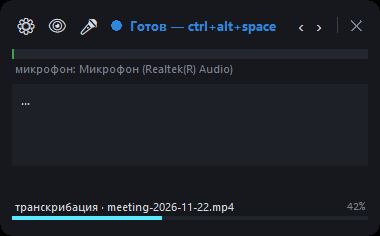
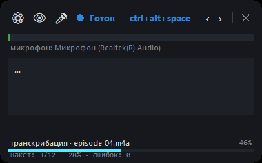

Транскрибация файлов — второй вход того же движка распознавания: вместо микрофона VibeForma берёт путь к файлу. Он берёт один файл за раз или целую папку пакетом, с живой полосой прогресса в панели. Всё остаётся на этом компьютере: без облака, отправки и внешнего бинарника `ffmpeg`.



*Один файл: состояние, имя, процент и настоящая полоса прогресса.*



*Пакет: текущий файл сверху, счётчик и общий процент снизу.*

## Что можно расшифровать

| Вход | Форматы |
|---|---|
| Видео | `mp4`, `mkv`, `mov`, `webm` |
| Аудио | `mp3`, `wav`, `m4a`, `m4b`, `ogg`, `flac` |

PyAV декодирует файл в 16 кГц моно float32 внутри приложения. Распознавание возвращает сегменты с началом и концом, поэтому результат можно записать как чистый текст или с таймкодами.

## Запуск одного файла

**Трей → «Транскрибировать файл…»** открывает диалог выбора файла и ставит его в очередь. Нужен запущенный сервис — модель уже должна быть загружена.

После завершения доступно **«Открыть папку результата»**, а уведомление называет путь к расшифровке.

## Запуск папки пакетом

**Трей → «Транскрибировать папку…»** спрашивает папку и ставит в очередь каждый поддерживаемый файл в ней. По умолчанию берётся только верхний уровень; для обхода подпапок включите **«Включать подпапки»** (`file_folder_recursive`, в командной строке — `--recursive`).

Правила пакета:

- одна очередь и один обработчик: файлы расшифровываются по одному, никогда параллельно;
- существующий результат пропускается, если не запрошена перезапись;
- два источника с одинаковым именем не могут делить один выход: второй становится записанной ошибкой, а пакет продолжается;
- один плохой файл записывается как ошибка, остальные всё равно обрабатываются;
- отмена останавливает текущий файл и всю очередь.

## Очередь и приоритет диктовки

Файлы и пакеты делят одну очередь с живой диктовкой, и диктовка всегда важнее. Если диктовка началась во время расшифровки файла, задача встаёт на паузу между сегментами и продолжается с того же файла, когда сервис снова свободен. Отмена кооперативная: текущий сегмент доходит до конца, затем задача останавливается.

В очереди один работающий файл. Длинный файл не блокирует горячую клавишу, панель и окно настроек.

## Полоса прогресса

Пока идёт файл или пакет, панель вырастает снизу. Полоса показывает:

| Элемент | Значение |
|---|---|
| Состояние и имя файла | `в очереди`, `транскрибация`, `пауза на диктовку`, `готово`, `ошибка` или `отменено`, затем текущий файл |
| Процент | Прогресс текущего файла от его длительности |
| Полоса | Движущийся сегмент, пока позиция неизвестна, и настоящее заполнение, когда процент известен |
| Счётчик | Для пакета: `N/M — P%` и число файлов с ошибкой |

Ошибка одного файла видна в полосе, пока пакет продолжается. Готовый результат держится 8 секунд и исчезает; диктовка, горячая клавиша и перетаскивание панели работают как обычно.

## Длинные файлы

Файл от 60 секунд идёт через `faster_whisper.BatchedInferencePipeline` на той же загруженной модели, блоками по 600 секунд, с тем же языком, VAD, промптом и настройками против галлюцинаций. Короткие файлы и диктовка остаются последовательными.

| Ключ | По умолчанию | Значение |
|---|---|---|
| `file_batched` | `true` | Использовать пакетный путь для длинных файлов |
| `file_batch_size` | `8` | Блоков за один пакетный проход, в пределах 1–16 |

Если пакетный путь недоступен или падает посреди файла, задача откатывается на последовательный путь без дублей текста. На тестовой машине проекта MP4 длиной 660 секунд с `large-v3-turbo` на CUDA float16 прошёл в 5,2 раза быстрее последовательного пути: 19,9 с медианы против 103,6 с. Это измерение на одной машине, а не обещание для любого файла.

Пакетный путь больше не невидимое исключение: каждый его сегмент проверяется теми же порогами, что и последовательный (`avg_logprob`, `no_speech_prob`, compression ratio), а проваливший сегмент распознаётся заново последовательно на своём куске блока. Предупреждение называет сегмент и повтор; замена проходит тот же пост-фильтр. Шов 600-секундных блоков несёт последние 200 символов предыдущего блока в следующую подсказку, поэтому имя, заданное в первом блоке, сохраняется во втором, а подсказка не растёт.

## Защита качества

- **Выдуманный текст отбрасывается.** Стоп-лист типовых ложных фраз на русском и английском, порог `no_speech_prob` 0,6, проверка compression ratio 1,35 на не-речи и порог тишины 2 секунды убирают текст, выдуманный на тишине и музыке, до того, как он попадёт в расшифровку. Петля повторов, которую движок читает как речь, остаётся с предупреждением.
- **Сломанный блок пословных таймкодов не роняет файл.** `IndexError` из `find_alignment` в faster-whisper 1.2.1 ловится на блоке, блок повторяется без таймкодов слов, предупреждение пишется в лог, а уже выданные сегменты не дублируются.
- **Управление на уровне задания.** Задание может нести свой `prompt` (до 1024 знаков), `word_timestamps` и `clip_timestamps`; применённые значения возвращает `/jobs/<id>`. Нечисловой или обратный диапазон отклоняется с `400`.

## Плашки субтитров

SRT и VTT режутся по предложениям, а не по 30-секундному окну движка: конец предложения или пауза 0,6 секунды закрывают плашку, а шов между окнами или 600-секундными блоками больше не разрывает предложение. Без таймкодов слов остаются сегменты движка. TXT и JSON не изменились.

## Лимиты

| Ключ | По умолчанию | Значение |
|---|---|---|
| `file_roots` | пусто | Пусто разрешает любой локальный фиксированный или съёмный диск; список ограничивает корни |
| `file_max_mb` | `4096` | Предел размера входного файла |
| `file_max_s` | `21600` (6 ч) | Предел длительности входа |
| `file_max_sync_s` | `900` (15 мин) | Предел синхронного API; длинные файлы идут в `/jobs` |
| `job_keep_s` | `86400` (24 ч) | Сколько готовая задача живёт в памяти |
| `file_word_timestamps` | `false` | Добавлять пословные таймкоды в JSON и резать SRT/VTT по предложениям |
| `file_folder_recursive` | `false` | Включать подпапки в диалоге папки |

Сетевые пути и UNC-ресурсы отклоняются: файл должен лежать на локальном диске. Полный список ключей — в [справочнике настроек](/ru/settings-reference/).

## Из командной строки

```powershell
.\run.cmd --transcribe "D:\audio\meeting.mp4"
.\run.cmd --transcribe-folder "D:\audio\podcast" --recursive --format srt
```

`--transcribe` печатает прогресс в stderr, а путь результата — в stdout; `--json` делает ответ машиночитаемым. `--transcribe-folder` печатает JSON-сводку. Оба обращаются к запущенному сервису через именованный канал текущего пользователя и не открывают порт. Полный контракт, включая коды выхода 0/1/2/3/4, — на странице [«Командная строка»](/ru/cli/).

## Куда попадают результаты

По умолчанию расшифровка пишется рядом с исходником, с тем же именем и расширением формата. `--out` называет другой файл или папку; для пакета дерево папки зеркалится в это место. Существующий результат не перезаписывается без `--force`.

Четыре формата — TXT, JSON, SRT и VTT — описаны на странице [«Форматы расшифровки»](/ru/formats/).

## Чего транскрибация файлов не делает

- Не расшифровывает несколько файлов параллельно: один обработчик, один файл за раз.
- Не переводит, не размечает говорящих и не вжигает субтитры в видео.
- Не читает с сетевого ресурса или облачного диска.
- Не требует и не использует `ffmpeg`: декодирование внутри.
- Не переписывает пунктуацию: знаки предложений приходят от Whisper, Silero не включён (ADR 0001).
- Не записывает системный звук: запись системного звука сама пишет WAV, TXT и SRT по остановке (см. [«Диктовка»](/ru/dictation/)); этот режим расшифровывает уже существующие файлы и папки.

## Что дальше

- [Форматы расшифровки](/ru/formats/) — четыре выхода и их поля.
- [Командная строка](/ru/cli/) — `--transcribe`, `--transcribe-folder` и коды выхода.
- [Локальный API](/ru/local-api/) — файлы по HTTP, включая API задач для длинных.
- [ИИ-агенты и интеграции](/ru/agents/) — обнаружение через `location.json`.
