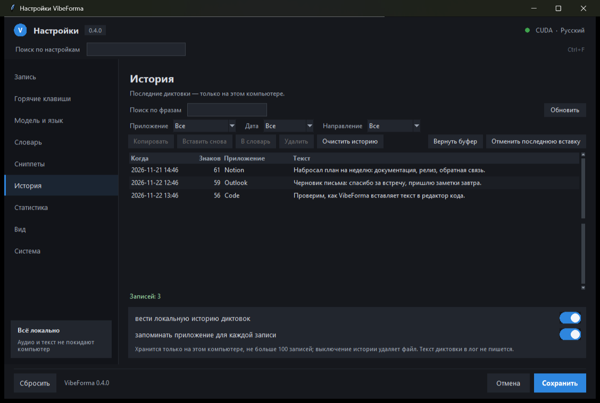

История — локальная необязательная запись ваших диктовок. По умолчанию она **выключена**. Когда вы её включаете, VibeForma хранит последние 100 диктовок в `history.jsonl` рядом с `config.json`.

Ничего никуда не отправляется. Файл остаётся на этом компьютере.

*Настройки → История: последние диктовки, когда история включена.*
## Что хранится

У каждой записи есть поля:

| Поле | Значение |
|---|---|
| `ts` | Когда была диктовка |
| `text` | Распознанный текст |
| `chars` | Число знаков |
| `app` | Приложение, получившее текст |
| `way` | Как доставлено: вставлено или скопировано |
| `audio` | Имя WAV-файла, только когда включён звук истории |

Записи пишутся атомарно, поэтому сбой не оставляет недописанную строку.

## Звук

`history_audio` по умолчанию выключен и работает только вместе с `history`. Когда включены оба, VibeForma хранит 16-битный WAV каждой диктовки в папке `history_audio` рядом с `history.jsonl`.

- Папка ограничена 200 МиБ; первым уходит самый старый файл, а у записи остаётся текст и пропадает только ссылка на пропавший звук.
- Удаление записи удаляет и её WAV. Очистка истории или выпадение записи из кольца на 100 записей делает то же.
- Выключение опции при старте удаляет звук, сохранённый прошлым запуском.

Звук локален, как и текст: он не выгружается, не синхронизируется и не входит в диагностику.

## Перераспознавание последней записи

**Трей → «Перераспознать последнюю»** спрашивает промпт и распознаёт WAV последней записи заново. Диалог предзаполнен `hotwords`; другую модель можно выбрать в трее до прохода. Новый текст приходит в черновик панели, где его можно править, копировать, вставить или отменить. Проходу нужен WAV, поэтому звук истории должен быть включён, а у записи должен остаться её звук.

## Включение и выключение истории

Переключатели находятся под таблицей истории в **Настройки → История**.

Выключение истории **удаляет файл**. Это намеренное поведение: отключение записи должно убирать записанное, а не хранить его тихо. Сохранённый звук уходит вместе с ним. Переключателя `history_audio` в окне настроек пока нет; ключ живёт в `config.json`.

## Таблица

Таблица занимает правую часть окна настроек и имеет четыре колонки:

| Колонка | Показывает |
|---|---|
| Когда | Дата и время |
| Знаков | Длина текста |
| Приложение | Куда ушёл текст |
| Текст | Распознанная фраза |

Таблица заполняет панель без прокрутки страницы; строки прокручиваются внутри таблицы.

## Поиск и фильтры

| Элемент | Поведение |
|---|---|
| Поиск | Ищет фразы в тексте и в имени приложения |
| Фильтр приложения | Сужает до одного приложения |
| Фильтр даты | Сегодня, последние 7 или 30 дней |
| Фильтр направления | Вставлено или скопировано |

Фильтры сочетаются: можно посмотреть сегодняшние скопированные фразы из одного приложения.

## Выделение и удаление

- Щёлкните строку, чтобы выделить её.
- `Ctrl+A` выделяет все строки.
- Несколько строк выделяются обычным расширенным выделением.
- Удаление — кнопкой или клавишей `Delete`.

Удаление записей истории не влияет на статистику. Статистика считает числа; история хранит текст. Это разные файлы и разные разделы.

## Отмена последней вставки

`Ctrl+Z` отменяет последнюю вставку, если выполнены все три условия:

1. Прошло не больше 30 секунд.
2. Это то же окно, которое получило текст.
3. Отмена ещё не использована.

VibeForma отправляет отмену по виртуальной клавише (`VK_Z`), поэтому это работает независимо от раскладки. Вне окна или после 30 секунд приложение предупреждает, а не отправляет слепое нажатие.

**Вернуть буфер** возвращает буфер обмена в состояние до диктовки.

## Просмотр истории на панели

При включённой истории стрелки `‹` и `›` в заголовке панели листают сохранённые диктовки. Ряд действий — корректировать, копировать, вставить в указанное место, отмена — работает над показанной записью. Нажатие горячей клавиши диктовки при фокусе на панели начинает новый черновик и очищает просмотр истории.

## Приватность

- История выключена, пока вы её не включите.
- Файл локальный: `history.jsonl` рядом с `config.json`.
- Выключение истории удаляет файл.
- Продиктованный текст никогда не пишется в лог.
- Заголовки окон не записываются; хранится только имя приложения.
- История не выгружается, не синхронизируется и не входит в диагностику.

## Ограничения

- 100 записей — фиксированный предел; старые записи вытесняются новыми.
- Экспорта таблицы истории нет.
- Звук истории выключен по умолчанию, переключателя в настройках пока нет, папка ограничена 200 МиБ.
- Перераспознавание работает только с последней записью и требует её WAV.
- Отмена ограничена последней вставкой, 30 секундами и тем же окном.

## Что дальше

- [Статистика](/ru/statistics/) — счётчики без текста.
- [Приватность](/ru/privacy/) — что хранится, а что нет.
- [Диктовка](/ru/dictation/) — вставка и отмена.
- [Файлы и расположение](/ru/files-and-paths/) — где лежит `history.jsonl`.
