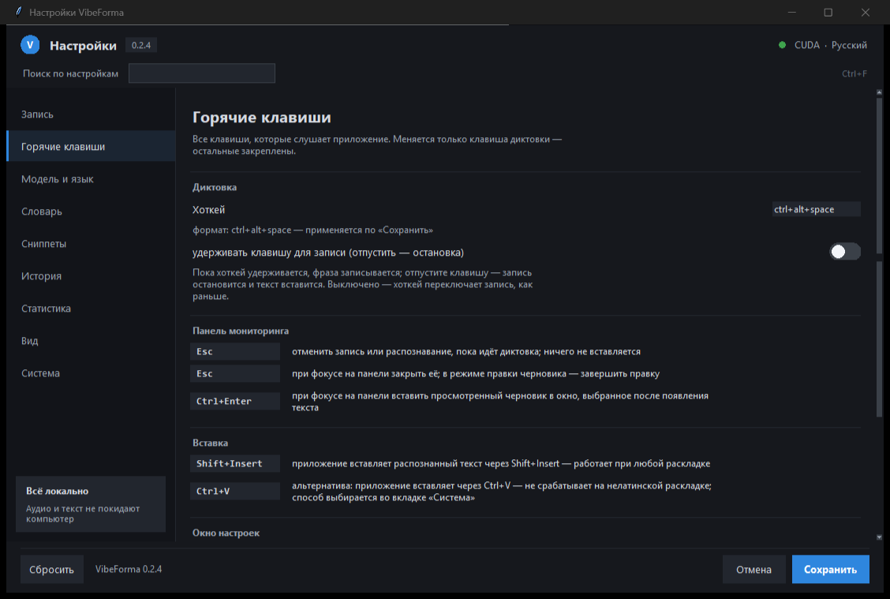

Это полный список клавиш, которые слушает приложение. Редактируется только горячая клавиша диктовки; остальные фиксированы и показаны здесь и в разделе **Настройки → Горячие клавиши** для сведения.

*Настройки → Горячие клавиши: единственная изменяемая клавиша и фиксированные сочетания.*
## Глобальные клавиши

| Клавиша | Действие | Редактируется |
|---|---|---|
| `Ctrl+Alt+Space` | Начать или остановить диктовку. В режиме удержания — держать, пока говорите. | Да |
| `Esc` | Отменить фразу в полёте — запись или черновик панели. Активна только во время диктовки. | Нет |

Горячую клавишу по умолчанию можно заменить другим сочетанием. Одни модификаторы не принимаются. Сочетание, занятое Windows или другим приложением, вызывает предупреждение, но выбор не блокируется молча.

## Клавиши вставки

| Клавиша | Действие | Примечания |
|---|---|---|
| `Shift+Insert` | Вставить распознанный текст | По умолчанию; не зависит от раскладки |
| `Ctrl+V` | Вставить распознанный текст | Альтернатива; выбирается через `paste_method` |
| `Ctrl+Enter` | Вставить черновик панели | Работает, когда в панели есть черновик |
| `Ctrl+Z` | Отменить последнюю вставку | В течение 30 секунд и в том же окне; приложение отправляет клавишу целевому окну |

`Ctrl+Z` — не глобальное сочетание VibeForma. Приложение отправляет отмену окну, получившему текст, по виртуальной клавише `VK_Z`, поэтому это работает с любой раскладкой.

## Окно настроек

| Клавиша | Действие |
|---|---|
| `Ctrl+F` | Перейти к полю поиска |
| `Ctrl+S` | Сохранить настройки, не закрывая окно; подтверждение появляется на месте |
| `Esc` | Закрыть окно |
| `Delete` | Удалить выделенные строки истории |
| `Ctrl+A` | Выделить все строки истории |

Кнопка **Reset** возвращает настройки по умолчанию, но сохраняет модель, словарь и историю.

## Смена горячей клавиши диктовки

1. Откройте **Настройки → Горячие клавиши**.
2. Нажмите на поле горячей клавиши.
3. Нажмите новое сочетание.
4. Сохраните через `Ctrl+S`.

Смена защищена:

- Невалидное сочетание не сохраняется.
- Новый слушатель стартует до остановки старого.
- Если новый слушатель не запустился, прежнее сочетание остаётся, а видимое уведомление объясняет причину.

## Какие клавиши не глобальны

VibeForma не занимает `Ctrl+F`, `Ctrl+S`, `Ctrl+A`, `Ctrl+V` и `Delete` на всю систему. Они работают, только когда фокус в окне настроек или в таблице истории. `Esc` глобален только во время диктовки.

## Что дальше

- [Диктовка](/ru/dictation/) — режимы и поведение вставки.
- [Настройки](/ru/settings/) — девять разделов.
- [История](/ru/history/) — таблица и фильтры.
- [Панель, трей и автозапуск](/ru/interface/) — меню трея.
