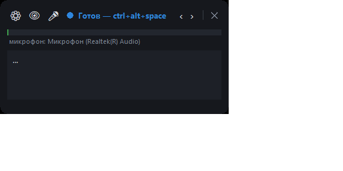
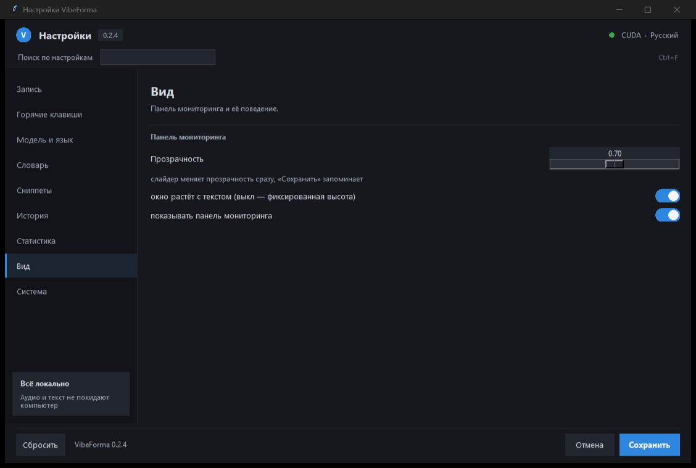

У VibeForma есть небольшая панель мониторинга, значок в трее и необязательный автозапуск. Панель — удобство, а не необходимость: диктовка работает и со скрытой панелью.

*Панель в покое: уровень микрофона, состояние и область текста.*

*Настройки → Вид: прозрачность, рост и приватность.*
## Панель мониторинга

Панель показывает:

- уровень микрофона и секундомер записи слева от него;
- индикатор VAD — есть ли голосовая активность;
- распознанный текст, который стримится во время речи;
- текущее состояние — idle, recording, processing, paused, error;
- последний черновик и ряд действий, когда черновик есть;
- подчёркнутые сомнительные слова в черновике и подсказку о языке, когда закреплён не тот;
- последнюю или две фразы как плашку субтитров во время записи системного звука.

| Поведение | Деталь |
|---|---|
| Прозрачность | `hud_alpha` |
| Авторасширение | `hud_autogrow`; высота считается от базовой на каждое изменение, поэтому панель не «ползёт» вверх за экран |
| Высота черновика | Не меньше 6 строк, когда появляется черновик |
| DPI | Геометрия масштабируется с фактором DPI, поэтому при 150% всё читается |
| Форма | Безрамочная панель, обрезанная до скруглённого региона; регион перестраивается после каждого ресайза |
| Поток | Tk работает в отдельном потоке |
| Закрытие | `✕` скрывает панель; значок в трее остаётся |

## Действия на панели

Кнопка микрофона начинает запись без горячей клавиши. Распознанный текст остаётся в панели, а под ним появляются действия:

| Действие | Что делает |
|---|---|
| **Корректировать** | Открывает черновик для правки. |
| **Копировать** | Кладёт черновик в буфер обмена. |
| **Вставить в указанное место** | Вставляет в окно, которое вы выберете после появления черновика; максимизированное окно остаётся максимизированным. |
| **Отмена** | Отбрасывает черновик. |
| **Распознать точнее** | На сомнительном черновике: распознаёт ту же запись заново с beam 10 при температуре 0 и заменяет черновик. |
| **Вернуть прежний** | Возвращает точный текст и подсветку, бывшие до широкого прохода. |

Сомнительные слова в черновике подчёркнуты. Две дополнительные кнопки появляются только когда применимы: на уверенной фразе нет ни той, ни другой, а **«Вернуть прежний»** появляется после успешного широкого прохода.

Если окно не выбрано, текст уходит в буфер. `Ctrl+Enter` вставляет черновик панели.

При включённой истории стрелки `‹` и `›` в заголовке панели листают сохранённые диктовки. Тот же ряд действий работает над показанной записью. Когда фокус на панели, горячая клавиша диктовки начинает новый черновик и очищает просмотр истории.

## Живые субтитры

С источником звука **«Системный звук»** панель показывает плашку с последней или двумя фразами вместо черновика. Текст никуда не вставляется; та же горячая клавиша останавливает запись. Плашка ограничена 400 символами и обновляется не чаще раза в 4 секунды, поэтому панель остаётся читаемой во время долгого фильма. На музыке выдуманная фраза всё же может появиться: у частичного результата нет `no_speech_prob` и compression ratio, поэтому отсекаются только короткий стоп-лист и петля повторов.

Та же запись ещё и пишется в файл: строка состояния панели называет WAV всю запись, уведомление повторяет путь, а по остановке рядом с WAV появляются TXT и SRT. Папка описана на странице [«Файлы и расположение»](/ru/files-and-paths/), режим и его пределы — на странице [«Диктовка»](/ru/dictation/).

## Секундомер записи

Слева от индикатора уровня панель показывает часы. В покое они скрыты и появляются вместе с записью:

| Запись | Что показывают часы |
|---|---|
| Микрофон с пределом (`continuous: false`) | Остаток до `max_record_s` со знаком минус — `−01:55` |
| Непрерывная диктовка (`continuous: true`, по умолчанию) | Прошедшее время записи, нейтрально |
| Системный звук | Прошедшее время записи, нейтрально |

Минус и отсчёт вниз есть только там, где есть предел; округление вверх, поэтому последняя секунда читается `00:01`, а раньше 30 секунд цифры становятся янтарными, раньше 10 — красными. Цифры моноширинные в колонке фиксированной ширины, поэтому строка под ними не сдвигается. Подсказка при наведении говорит, что считает число: «осталось до предела записи (MM:SS)» или «время записи». Предел фиксируется на старте записи, поэтому смена настроек в середине действует на следующую, а запись, закончившаяся раньше по тишине, заканчивается до нуля отсчёта — часы называют предел, а не единственный конец.

## Режим приватности

Кнопка-глаз скрывает стриминг и последний текст. Уровень микрофона остаётся видимым, поэтому видно, что приложение вас слышит. Строка статуса исчезает через 30 секунд.

`hud_privacy: true` запускает панель сразу в режиме приватности.

## Оверлей распознавания

Пока фраза распознаётся, панель затемняется и по ней бежит процент. Процент — анимированная оценка, а не измерение:

- около 90% за первые полсекунды;
- потолок 96%, пока текст не готов;
- 100% только когда текст действительно готов.

Тонкая линия идёт от льда к циану, а при появлении текста оверлей затухает.

## Кнопка обновления

Когда найден новый релиз, на панели появляется синяя кнопка **Обновить**. Она использует тот же путь обновления, что трей и настройки.

## Полоса прогресса файлов

Файл или пакет папки добавляет внизу панели полосу. Она показывает состояние, имя текущего файла, его процент, полосу прогресса и — для пакета — счётчик `N/M — P%` с числом файлов с ошибкой. Полоса живёт всю очередь, показывает ошибку одного файла, пока пакет продолжается, и скрывает готовый результат через 8 секунд.

Полоса никогда не занимает место оверлея диктовки: у диктовки приоритет, и она ставит файл на паузу между сегментами. Подробнее — на странице [«Транскрибация файлов»](/ru/file-transcription/).

## Меню трея

Значок в трее окрашивается по состоянию сервиса. В меню такие пункты; условные появляются только когда применимы:

1. Настройки
2. Показать панель
3. **Транскрибировать файл…**
4. **Транскрибировать папку…**
5. Отменить пакет — пока пакет идёт
6. Открыть папку результата — после завершённой файловой задачи
7. Помощник настройки
8. Диагностика
9. Release notes — когда найден релиз
10. Обновить до `<версия>` — когда найден релиз
11. Обновить позже — когда найден релиз
12. Пауза / продолжить
13. Устройство ввода
14. Модель
15. Язык распознавания
16. История
17. Перераспознать последнюю — спрашивает промпт и кладёт новый текст в черновик панели
18. Отменить последнюю вставку
19. Папка логов
20. Выход

Трей — путь назад, когда панель скрыта. Повторный запуск не создаёт вторую копию: он просит работающий экземпляр показать панель.

## Автозапуск

Автозапуск создаёт установщик, а переключается он в **Настройки → Система**. Сервис стартует вместе с Windows, поэтому горячая клавиша доступна, ничего не открывая.

## Один экземпляр

Блокировка второго запуска (`service.lock`) не даёт двум сервисам работать одновременно. Два сервиса дрались бы за микрофон, горячую клавишу и порт локального API.

## status.json

Сервис пишет `status.json` на каждом изменении состояния. Это удобство для скриптов, а не источник истины. В файле состояние, версия, pid и метка времени. Ответ старше 60 секунд не считается достоверным.

## Что дальше

- [Горячие клавиши](/ru/hotkeys/) — клавиши панели и настроек.
- [Диктовка](/ru/dictation/) — полный цикл диктовки.
- [Транскрибация файлов](/ru/file-transcription/) — действия трея и полоса прогресса.
- [Обновления](/ru/updates/) — как ведёт себя кнопка обновления.
- [Файлы и расположение](/ru/files-and-paths/) — `status.json`, `service.lock` и логи.
