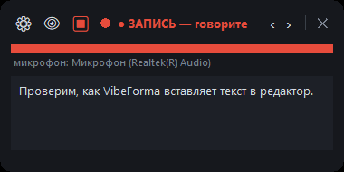

VibeForma — локальное приложение голосовой диктовки для Windows. Нажмите горячую клавишу, говорите, и распознанный текст появляется там, где стоит курсор: в редакторе, браузере, окне чата или IDE.

**От голосового вайба — к чёткой форме.**

*Панель во время записи фразы.*
## Какую задачу решает

Говорить быстрее, чем печатать, но большинство сервисов диктовки отправляют голос в облачный аккаунт. VibeForma распознаёт речь на вашей машине. Сеть нужна один раз — чтобы скачать модель распознавания, — и позже для проверки обновлений. Аккаунтов и телеметрии нет.

## Как работает диктовка

1. Поставьте курсор туда, где должен появиться текст.
2. Нажмите `Ctrl+Alt+Space` — горячую клавишу по умолчанию. В режиме удержания держите её, пока говорите.
3. Говорите. Панель показывает распознанный текст по мере распознавания.
4. Остановитесь: нажмите клавишу ещё раз, отпустите её в режиме удержания или просто сделайте паузу. После 2 секунд тишины фраза завершается.
5. Готовый текст вставляется в позицию курсора.

Распознавание использует faster-whisper — локальную реализацию модели Whisper. Язык распознавания фиксирован: модель распознаёт ровно выбранный язык, без автоопределения.

## Что входит

- **Диктовка** в режимах toggle или удержания, с определением речи (VAD), лимитом фразы 120 секунд и отменой по `Esc`.
- **Транскрибация файлов** — аудио и видео на том же локальном движке, включая пакеты папок, четыре формата выхода и полосу прогресса в панели.
- **Панель мониторинга** с уровнем микрофона, индикатором VAD, потоком текста, режимом приватности и действиями над последним черновиком.
- **Девять разделов настроек**, которые применяются к работающему сервису без перезапуска.
- **Четыре модели** — large-v3, large-v3-turbo (по умолчанию), medium и small — переключаются без перезапуска приложения, с откатом при неудачной загрузке.
- **Словарь** терминов и замен и **сниппеты** для произносимых триггеров.
- **История** — выключена по умолчанию, хранит последние 100 диктовок, — и **статистика**, которая хранит числа, а не текст.
- **Панель, значок в трее и автозапуск**, один работающий экземпляр и ротация логов.
- **Командная строка** (`--toggle`, `--cancel`, `--status`, `--transcribe`, `--transcribe-folder`, `--doctor`, `--selftest`) и необязательный локальный HTTP API на `127.0.0.1`.
- **Английский и русский** интерфейс и документация.

VibeForma бесплатна и распространяется с открытым исходным кодом по лицензии MIT.

## Чего она не делает

VibeForma 0.4.5 — локальный инструмент диктовки и транскрибации файлов, а не платформа встреч и медиа:

- Работает только на Windows.
- Не определяет язык автоматически; язык выбираете вы.
- Транскрибирует файлы по одному, а не несколько параллельно.
- Не делает сводок встреч, не разделяет говорящих, не переводит и не вжигает субтитры в видео.
- Не имеет облака, аккаунтов, команд и биллинга.

Полный список — в разделе [Известные ограничения](/ru/known-issues/).

## Что дальше

- [Быстрый старт](/ru/quickstart/) — установить и продиктовать первую фразу.
- [VibeForma и аналоги](/ru/comparison/) — сравнение с другими инструментами диктовки и транскрибации.
- [Диктовка](/ru/dictation/) — режимы, вставка и панель.
- [Приватность](/ru/privacy/) — что остаётся на вашей машине и когда используется сеть.
- [VibeForma в FormaMind](/ru/formamind/) — как приложение работает голосовым слоем проектного инструмента.
