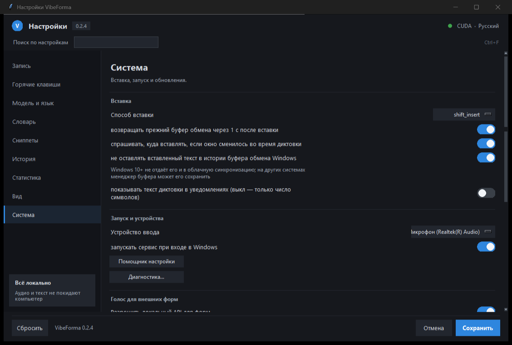

VibeForma может открыть небольшой HTTP API для локальных инструментов. По умолчанию он **выключен**. Когда он включён, он слушает только `127.0.0.1` и требует токен.

Это технический мост для редакторов, скриптов и агентов — поверхность, которую FormaMind может использовать без облачного аккаунта.



*Настройки → Система: переключатель локального API.*
## Включение API

1. Откройте **Настройки → Система**.
2. Включите локальный API.
3. VibeForma автоматически создаёт и сохраняет токен API при первом включении.
4. Слушатель стартует на живом сервисе без перезапуска.

Если токена нет, сервер не стартует. Отказ fail-closed: нет токена — нет слушателя.

## Адрес и порт

| Параметр | Значение |
|---|---|
| Адрес привязки | Только `127.0.0.1` |
| Порт по умолчанию | `8787` |
| Занятый порт | Автоматически занимается свободный loopback-порт |
| Обнаружение | `location.json` публикует фактический порт |
| Доступ с другой машины | Нет |

Инструменты должны читать `location.json`, а не предполагать 8787:

```json
{
  "schema": 1,
  "app": "VibeForma",
  "version": "0.2.4",
  "config": "C:\\Users\\you\\AppData\\Local\\VibeForma\\config.json",
  "api": "on",
  "port": 8787
}
```

Секрета в файле нет. Токен остаётся в `config.json`.

## Аутентификация

Каждый запрос должен нести токен:

```
X-VibeForma-Token: <token>
```

Сравнение постоянного времени (`hmac.compare_digest`). Отсутствующий или неверный токен возвращает `401`.

Читайте токен из `config.json` в своём клиенте; не вшивайте его в общий скрипт и не коммитьте.

## Эндпоинты

### `GET /health`

Сообщает состояние сервиса:

| Поле | Значение |
|---|---|
| `ok` | Здоров ли сервис |
| `app` | Имя приложения |
| `api` | Состояние API |
| `port` | Фактический порт прослушивания |
| `version` | Версия продукта |
| `model` | Загруженная модель |
| `language` | Язык распознавания |
| `state` | idle, recording, processing, paused, updating, error |

### `POST /transcribe`

Распознаёт одну короткую WAV-запись.

| Требование | Значение |
|---|---|
| Метод и путь | `POST /transcribe` |
| Заголовок | `X-VibeForma-Token` |
| Тип содержимого | `audio/wav` |
| Тело | Байты WAV |
| Максимальный размер | 10 МБ |
| Частота | Не чаще одного запроса в секунду |
| Состояние сервиса | Только когда сервис свободен; у диктовки приоритет |

При успехе ответ несёт распознанный текст в JSON. Временный WAV с именем `_http_in_*.wav` создаётся в папке логов и удаляется при любом исходе.

## Коды ответов

| Код | Когда |
|---|---|
| `200` | Запрос выполнен |
| `401` | Токен отсутствует или неверен |
| `404` | Неизвестный путь |
| `409` | Сервис занят — например, идёт диктовка |
| `411` | Нет `Content-Length` |
| `413` | Тело больше 10 МБ |
| `415` | `Content-Type` не `audio/wav` |
| `429` | Больше одного запроса в секунду |

Отклонённый запрос дочитывается до 1 МБ и только потом получает ответ, поэтому клиент видит код состояния, а не сброс соединения.

## Примеры

### PowerShell

```powershell
$config = Get-Content "$env:LOCALAPPDATA\VibeForma\config.json" | ConvertFrom-Json
$token = $config.http_token

Invoke-RestMethod -Uri "http://127.0.0.1:8787/health" `
  -Headers @{ "X-VibeForma-Token" = $token }

Invoke-RestMethod -Uri "http://127.0.0.1:8787/transcribe" `
  -Method Post `
  -Headers @{ "X-VibeForma-Token" = $token } `
  -ContentType "audio/wav" `
  -InFile "C:\audio\phrase.wav"
```

### curl

```bash
curl -s http://127.0.0.1:8787/health \
  -H "X-VibeForma-Token: $VIBEFORMA_TOKEN"

curl -s -X POST http://127.0.0.1:8787/transcribe \
  -H "X-VibeForma-Token: $VIBEFORMA_TOKEN" \
  -H "Content-Type: audio/wav" \
  --data-binary @phrase.wav
```

## Чего API не делает

- Не принимает аудио с другой машины.
- Не транскрибирует длинные файлы. Лимит 10 МБ WAV и один запрос в секунду — лимиты диктовки; транскрибация файлов заявлена для 0.3.0.
- Не открывает настройки, историю или словарь.
- Не использует TLS, потому что трафик не покидает loopback.

## Замечания по безопасности

- Слушатель только на loopback; удалённый клиент до него не дотянется.
- Токен требуется в каждом запросе и сравнивается постоянным временем.
- Ограничение частоты и ответ «занято» не дают API конкурировать с живой диктовкой.
- Временное аудио удаляется при любом исходе.
- Токен лежит в `config.json`; вырезайте его перед передачей логов или файла.

Подробнее — в разделе [Безопасность](/ru/security/).

## Если запрос не проходит

| Симптом | Проверка |
|---|---|
| Соединение отклонено | API выключен или сервис не запущен |
| `401` | Токен в запросе не совпадает с `config.json` |
| `404` | Путь — `/health` или `/transcribe`; другого нет |
| `409` | Сервис пишет или распознаёт; повторите в простое |
| `413` | WAV больше 10 МБ; отправьте фразу короче |
| `415` | Укажите `Content-Type: audio/wav` |
| `429` | Подождите не меньше секунды между запросами |

## Что дальше

- [Командная строка](/ru/cli/) — хук и флаги.
- [Безопасность](/ru/security/) — модель угроз и сообщение об уязвимости.
- [Файлы и расположение](/ru/files-and-paths/) — `location.json` и `config.json`.
- [VibeForma в FormaMind](/ru/formamind/) — интеграция, которой служит этот API.
