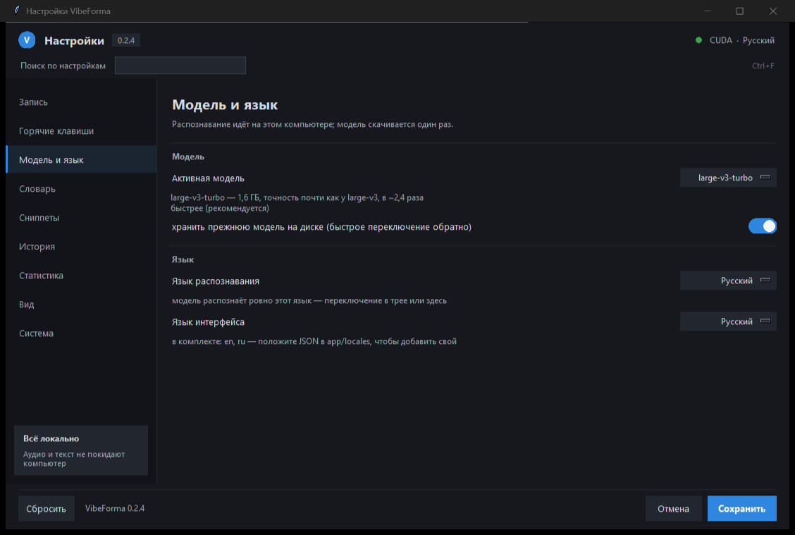

VibeForma держит одну модель загруженной на всё время жизни сервиса. Модель и язык распознавания выбираете вы; приложение не угадывает ни то, ни другое.

*Настройки → Модели и язык: одна активная модель и точный язык распознавания.*
## Четыре модели

| Модель | Примерный размер | Роль |
|---|---|---|
| `large-v3` | 3,1 ГБ | Самое высокое качество из четырёх; самая медленная. |
| `large-v3-turbo` | 1,6 ГБ | По умолчанию. Гораздо быстрее large-v3, пунктуация чуть слабее. |
| `medium` | 1,5 ГБ | Средний вариант для слабых машин. |
| `small` | 0,5 ГБ | Самая маленькая; установщик предлагает её на машине только с CPU. |

Замер README — фраза 12,5 секунды, CUDA float16, лучшее из трёх — 1,53 с для `large-v3` и 0,64 с для `large-v3-turbo`, примерно в 2,4 раза быстрее. Это единственные опубликованные замеры; не ждите тех же чисел на другом железе.

## Как выбрать

- **Начните с `large-v3-turbo`.** Она по умолчанию не случайно: качество почти как у large, а времени тратит в разы меньше.
- **Выбирайте `large-v3`**, когда точность важнее задержки и машина выдерживает 3,1 ГБ.
- **Выбирайте `medium` или `small`**, когда ограничены память, диск или CPU, либо когда вы диктуете короткие фразы и нужна минимальная задержка.
- **На машине только с CPU** разумная отправная точка — `small`; установщик выбирает её для необслуживаемой установки на CPU.

Качество зависит ещё и от микрофона, комнаты и языка. Большая модель не исправит плохой входной сигнал.

## Смена модели

Модель меняется в **Настройки → Модель и язык** или из трея. Перезапуск не нужен.

Смена проходит четыре фазы:

1. **download** — скачать модель, если её нет на диске;
2. **load** — загрузить в сервис;
3. **remove** — удалить старую модель, если вы решили её не оставлять;
4. **done**.

Если загрузка или скачивание не удались, прежняя модель восстанавливается. Если идёт диктовка, смена отвечает «busy», а не прерывает её.

`model_keep_old` определяет, остаётся ли прежняя модель на диске. Если оставить — обратная смена быстрая, но занимает место. Когда опция выключена, удаляться может только скачанная модель внутри `models\`: абсолютный путь, шаг `..`, другой диск или ссылка наружу отклоняются, поэтому добавленная вами папка никогда не становится целью удаления.

## Обновления моделей

С версии 0.5.5 фоновая проверка раз в 24 часа (`model_update_interval_h`, ключ `model_update_check` её отключает) сверяет скачанные модели каталога с Hugging Face. Когда есть более новая ревизия, **Настройки → Модель и язык** предлагают её кнопками **«Обновить»** и **«Не сейчас»** и одним уведомлением в трее; кнопка **«Проверить обновления модели»** запускает проверку вручную. Отклонённая ревизия не предлагается снова даже после перезапуска.

Обновление идёт только по вашему клику, по одной модели за раз и только при свободной службе без файловой очереди — иначе понятный отказ «дождитесь окончания». Новая ревизия скачивается во временную папку, проверяется тем же гейтом, что и любая модель, и занимает место старой. Прежняя ревизия **сохраняется на диске** рядом с папкой модели как `previous-<модель>-<ревизия>`: удалите её, чтобы вернуть место, или поменяйте папки местами, чтобы откатиться без повторной загрузки. Любой сбой скачивания, проверки или загрузки возвращает прежнюю папку и рабочую модель. Без сети диктовка не страдает — проверка просто молчит.

Папки `model_folders` не проверяются и не обновляются. Модель, живущая только в общем кэше Hugging Face, сначала копируется в `models\`, сам кэш не удаляется.

## Локальные папки моделей

**«Настройки → Модель и язык»** хранит список папок CT2-моделей, между которыми можно переключаться, не вводя путь. Каждая строка показывает имя папки, её путь и признак валидности; текущая модель отмечена. Кнопки работают так:

| Кнопка | Что делает |
|---|---|
| **«Добавить папку»** | Открывает выбор каталога и отклоняет папку без `model.bin` понятной ошибкой; дубль не добавляется. |
| **«Использовать»** | Переключает на папку через тот же диалог прогресса, поэтому неудачное переключение оставляет модель, которая была в работе. |
| **«Убрать из списка»** | Удаляет только запись, а не файлы. Запись текущей модели остаётся с объяснением. |
| **«Вернуть встроенную»** | Снова выбирает модель каталога. |

Валидность — наличие `model.bin`, она считается при каждой отрисовке списка, поэтому папка, потерявшая файл, становится невалидной, а не сохраняет устаревшую отметку. Это проверка наличия, а не глубокая инспекция: повреждённые веса выявляются при загрузке модели, а модель, бывшая в работе, сохраняется.

Список живёт в `config.json` как `model_folders` — записи `{name, path}`, абсолютные пути, без дублей, до 20 — переживает перезапуск, а старая конфигурация без ключа читается как пустой список. Ручной путь в `model` продолжает работать рядом с ним.

### Откуда берётся модель

VibeForma ищет модель в таком порядке:

1. `models\<имя>` внутри папки сервиса;
2. общий кэш Hugging Face;
3. свежая загрузка.

Этот порядок позволяет переустановке работать офлайн, если модель уже есть. Папка из локального списка используется по своему пути как есть и в этом порядке не ищется.

## CUDA и CPU

| Профиль | Точность | Когда |
|---|---|---|
| NVIDIA CUDA | float16 | Найдена видеокарта NVIDIA и рабочая установка CUDA |
| CPU | int8 | Нет рабочей CUDA или передан `-Cpu` |

Колёса CUDA ставятся только для профиля CUDA. Если в `config.json` указано `cuda`, а рабочей CUDA на машине нет, VibeForma исправляет конфигурацию, а не проваливает каждую диктовку.

## Языки

Два разных числа, которые часто путают:

- **Модель** поддерживает около 99 языков. Это свойство Whisper.
- **Меню распознавания** предлагает 26 кодов языков. Это список, который показывает VibeForma.

Язык распознавания точен. Модель распознаёт выбранный язык и ничего больше. Это сделано намеренно — автоопределение на коротких фразах и смешанной лексике ненадёжно, а ошибка портит всю фразу.

Названия языков показываются эндонимами — English, Русский, Українська, Deutsch, — каждый язык на своём письме. Код хранится в `config.json`.

Язык меняется в **Настройки → Модель и язык** или из трея. Применяется без перезапуска.

### Пресеты подсказок

Для каждого из 26 языков меню VibeForma добавляет языковую подсказку для пунктуации и заглавных букв. Личные термины из `hotwords` всегда идут в начальную подсказку независимо от языка.

### Один язык за раз

VibeForma распознаёт один выбранный язык на фразу. Она не переводит и не переключает язык внутри фразы. При смешанной речи выберите доминирующий язык, а иностранные термины добавьте в словарь или в `hotwords`.

## Что дальше

- [Диктовка](/ru/dictation/) — как захватывается и вставляется фраза.
- [Словарь](/ru/dictionary/) — термины и замены.
- [Системные требования](/ru/requirements/) — факты о диске и GPU.
- [Справочник настроек](/ru/settings-reference/) — ключи модели и языка.
