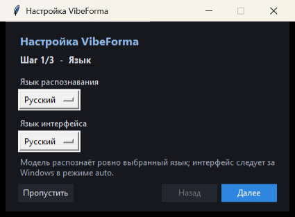

Этот учебный раздел проводит от чистой машины Windows до первого продиктованного предложения. Обычно уходит около десяти минут, большая часть — загрузка модели.



*Мастер из трёх шагов при первом запуске.*
## Перед началом

- Windows 10 (сборка 1809 или новее) или Windows 11, x64 или ARM64.
- Python 3.10–3.14, доступный установщику. Установщик проверяет это до любых изменений.
- Свободное место под модель плюс около 4 ГБ. Модель по умолчанию `large-v3-turbo` занимает около 1,6 ГБ.
- Микрофон. Подойдёт USB-гарнитура или встроенный микрофон.
- Права администратора не нужны: VibeForma ставится в `%LOCALAPPDATA%\VibeForma`.

Полная таблица — в разделе [Системные требования](/ru/requirements/).

## Установка

Откройте PowerShell и выполните:

```powershell
irm https://raw.githubusercontent.com/FormaMindPro/vibeforma/main/install.ps1 | iex
```

Установщик находит Python, скачивает последнюю выпущенную сборку, создаёт виртуальное окружение, ставит зависимости, скачивает модель распознавания, создаёт ярлыки и запускает сервис.

Чтобы выбрать модель или каталог установки, передайте параметры:

```powershell
irm https://raw.githubusercontent.com/FormaMindPro/vibeforma/main/install.ps1 -OutFile install.ps1
.\install.ps1 -Model small -Target D:\VibeForma
```

Все параметры перечислены в разделе [Установка](/ru/installation/).

## Первый запуск

При первом старте появляется помощник из трёх шагов:

1. **Язык интерфейса и распознавания.** Выберите язык приложения и язык, который должна распознавать модель. Язык распознавания фиксирован и не определяется автоматически.
2. **Микрофон.** Выберите устройство ввода и посмотрите на живой уровень. Нажмите **Проверить микрофон**, чтобы записать короткую фразу. Распознанный текст показывается и никуда не вставляется.
3. **Горячая клавиша.** Нажмите сочетание, которое хотите использовать для диктовки. Одни модификаторы не принимаются. **Пропустить** записывает безопасные значения по умолчанию.

Помощник можно открыть позже из меню трея и из настроек.

## Продиктуйте первую фразу

1. Откройте любое текстовое поле — «Блокнот», браузер, окно чата.
2. Поставьте курсор туда, где должен появиться текст.
3. Нажмите `Ctrl+Alt+Space` и произнесите предложение.
4. Сделайте паузу на две секунды или нажмите клавишу ещё раз. Фраза завершается автоматически после 2 секунд тишины.
5. Текст появляется в позиции курсора.

Если панель видна, она показывает уровень микрофона и текст по мере распознавания.

## Проверьте результат

- Текст вставляется в окно, активное в момент нажатия горячей клавиши.
- Уведомление сообщает число знаков, а не сам текст.
- Если перед диктовкой вы что-то скопировали, прежний буфер обмена возвращается примерно через секунду.

## Транскрибируйте файл

1. Щёлкните значок в трее правой кнопкой и выберите **«Транскрибировать файл…»**.
2. Выберите аудио- или видеофайл — `mp4`, `mkv`, `mov`, `webm`, `mp3`, `wav`, `m4a`, `m4b`, `ogg` или `flac`.
3. Смотрите на полосу внизу панели: состояние, имя файла и процент. Диктовка продолжает работать и ставит файл на паузу между сегментами.
4. Когда файл готов, уведомление называет расшифровку; **Трей → «Открыть папку результата»** открывает её папку.

Для целой папки выберите **«Транскрибировать папку…»**; верхний уровень включается по умолчанию. Результаты ложатся рядом с исходниками в SRT, если не выбран другой формат. Подробнее — [«Транскрибация файлов»](/ru/file-transcription/).

## Если что-то не работает

- Текст не появляется: убедитесь, что курсор стоит в текстовом поле, и попробуйте `Shift+Insert`. Эта вставка не зависит от раскладки.
- Микрофон молчит: откройте **Настройки → Запись**, выберите другое устройство ввода и снова нажмите **Проверить микрофон**.
- Горячая клавиша не срабатывает: возможно, сочетание занято другим приложением. Выберите другое в разделе **Настройки → Горячие клавиши**.
- Модель не скачалась: проверьте сеть и свободное место, затем повторите из установщика или через **Настройки → Модель и язык**.

Подробнее — в разделах [Решение проблем](/ru/troubleshooting/) и [Диагностика и логи](/ru/diagnostics/).

## Что дальше

- [Диктовка](/ru/dictation/) — режимы, вставка и панель.
- [Транскрибация файлов](/ru/file-transcription/) — файлы, пакеты папок и полоса прогресса.
- [Настройки](/ru/settings/) — девять разделов и что они меняют.
- [Словарь](/ru/dictionary/) — научите VibeForma своим именам и терминам.
- [Горячие клавиши](/ru/hotkeys/) — все клавиши, которые слушает приложение.
