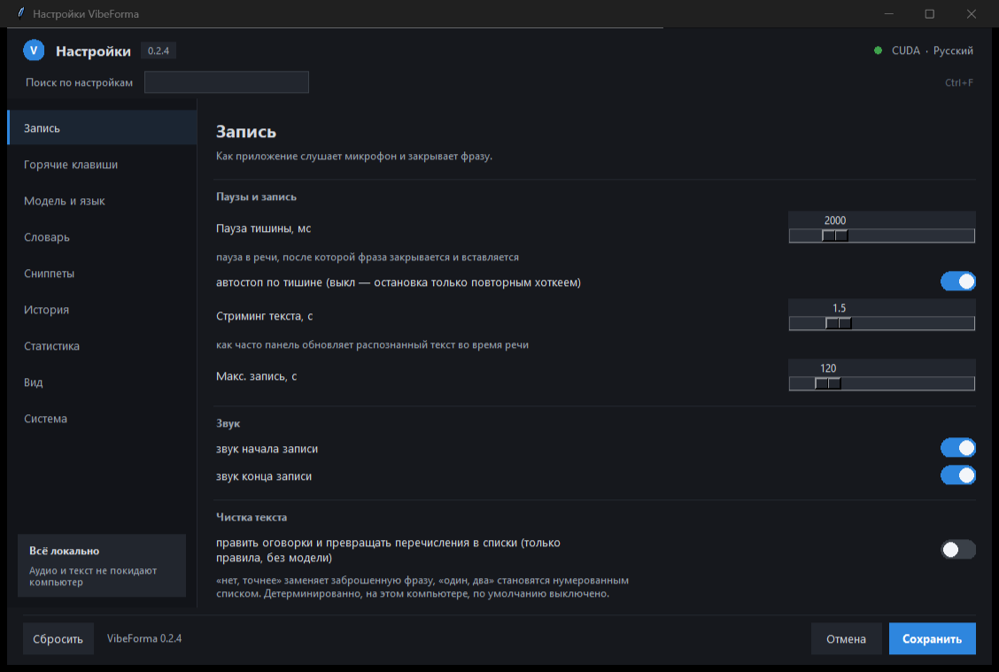

В окне настроек есть сайдбар с девятью разделами. У каждого раздела заголовок и однострочное описание; булевы опции — переключателями, футер Save/Cancel прибит к низу.

Окно открывается из меню трея или с панели. Изменения применяются к работающему сервису без перезапуска.

*Настройки → Запись: паузы, стриминг, лимит фразы и звук.*
## Девять разделов

### 1. Запись

Устройство ввода, режим диктовки и тайминги фразы:

- устройство микрофона;
- источник звука — микрофон или системный звук; запись системного звука питает живые субтитры, пишется в WAV и получает рядом TXT и SRT;
- папка записей системного звука — поле показывает действующий путь, а кнопки **«Изменить…»**, **«Открыть»** и **«По умолчанию»** работают с ним; WAV, TXT и SRT пишутся в эту папку с подпапкой даты, **«По умолчанию»** возвращает `Documents\VibeForma\Recordings` (`system_recordings_dir`, пусто — умолчание);
- качество распознавания — **«Обычный (рекомендуется)»**, **«Точный»** или **«Быстрый»**; пресет задаёт ширину поиска и резерв финального прохода диктовки, отдельной настройки температуры нет;
- удержание или toggle;
- тишина до завершения фразы — `silence_ms`, по умолчанию 2000;
- максимальная длина фразы — `max_record_s`, по умолчанию 120 секунд; действует, когда непрерывная диктовка выключена;
- интервал частичных транскрипций — `partial_every_s`, по умолчанию 1,5 секунды;
- звуковые сигналы начала и конца;
- метод вставки — `Shift+Insert` или `Ctrl+V`;
- возврат буфера обмена;
- исключение из истории буфера Windows;
- показывают ли уведомления текст.

### 2. Горячие клавиши

Редактируемая горячая клавиша диктовки и фиксированный список всех остальных клавиш, которые слушает приложение. Полная таблица — в разделе [Горячие клавиши](/ru/hotkeys/).

Смена клавиши защищена: невалидное сочетание не сохраняется, новый слушатель стартует до остановки старого, при сбое прежнее сочетание остаётся с видимым уведомлением.

### 3. Модель и язык

- модель распознавания: `large-v3`, `large-v3-turbo`, `medium`, `small` — или путь к папке сконвертированной CT2-модели;
- локальные папки моделей — список папок CT2 с именем, путём и валидностью, **«Добавить папку»**, **«Использовать»**, **«Убрать из списка»** (только запись, не файлы) и **«Вернуть встроенную»**; список — это `model_folders`, до 20, текущая папка отмечена;
- язык распознавания: один из 26 кодов, фиксирован, без автоопределения; подсказка называет вероятный другой язык, когда закреплён не тот;
- личные термины (`hotwords`), которые идут в каждое 30-секундное окно распознавания;
- остаётся ли прежняя модель на диске после смены — папка, добавленная вами, при смене не удаляется.

Смена модели открывает диалог прогресса из четырёх фаз: **download → load → remove → done**. Если идёт диктовка, ответ — «busy». Неудачная загрузка или смена откатывает всё назад либо оставляет модель, которая была в работе. Модель-путь загружается из папки с `local_files_only`; папка без `model.bin`, `config.json`, `tokenizer.json` или словаря отклоняется понятной ошибкой вместо скачивания другой модели. Папка без `model.bin` отклоняется сразу при добавлении в список. Подробнее — [«Модели и языки»](/ru/models/).

### 4. Словарь

Пары термин → замена, до 500, с импортом, экспортом и предпросмотром. Обучение из правок предлагается здесь после повторяющейся правки. На этой же вкладке — профили приложений: словарь и сниппеты, привязанные к имени процесса и/или фрагменту заголовка окна. Подробнее — [Словарь](/ru/dictionary/).

### 5. Сниппеты

Произносимый триггер → подготовленный текст, до 500 пар, с импортом, экспортом, предпросмотром и валидацией. Подробнее — [Сниппеты](/ru/snippets/).

### 6. История

Необязательная запись последних 100 диктовок: таблица, поиск, фильтры, выделение, удаление и переключатели под таблицей. Звук — отдельный ключ `history_audio`, переключателя здесь пока нет. Подробнее — [История](/ru/history/).

### 7. Статистика

Счётчики диктовок, слов, знаков и секунд по дням, итоги и последние 30 дней, со сбросом по подтверждению. Хранятся только числа. Подробнее — [Статистика](/ru/statistics/).

### 8. Вид

Прозрачность панели (`hud_alpha`), авторасширение (`hud_autogrow`), запуск в режиме приватности (`hud_privacy`) и показ или скрытие панели. Подробнее — [Панель, трей и автозапуск](/ru/interface/).

### 9. Система

Автозапуск, проверка обновлений и её интервал, ручное действие **Проверить сейчас**, переключатель и порт локального HTTP API, папка логов, диагностика и версия приложения.

## Опции, которые живут только в config.json

У части опций этого релиза пока нет элемента в окне. Они читаются из `config.json` при старте сервиса:

| Ключ | По умолчанию | Что делает |
|---|---|---|
| `continuous` | `true` | Делит длинную запись по паузам или каждые 30 секунд вместо остановки на `max_record_s` |
| `dictation_context` | `false` | Добавляет предыдущую фразу и выделенный текст в `hotwords` следующей диктовки |
| `text_cleanup` | `false` | Превращает числа и даты, удаляет слова-паразиты и ставит заглавные |
| `history_audio` | `false` | Хранит WAV каждой диктовки, включает «Перераспознать последнюю» и перераспознавание одной записи |
| `actions` | пусто | Произносимые фразы, запускающие команду, смену модели или агента |

## Поведение окна

| Поведение | Деталь |
|---|---|
| Поиск | `Ctrl+F` переводит фокус в поле поиска |
| Сохранение | `Ctrl+S` сохраняет, не закрывая окно; подтверждение появляется на месте |
| Закрытие | `Esc` закрывает окно |
| Reset | Возвращает настройки по умолчанию; модель, словарь и история сохраняются |
| Геометрия | Размер считается один раз от самой высокой вкладки, ограничивается экраном и центрируется |
| Прокрутка | Каждая вкладка прокручивается тёмной полосой при необходимости |
| Таблицы | История и статистика заполняют панель без прокрутки страницы |
| DPI | Размеры окна и панели масштабируются с фактором DPI, поэтому при 150% всё читается |
| Углы | Скруглённые углы и тёмная полоса заголовка через DWM |

## Что применяется на живом сервисе

Эти изменения доходят до работающего сервиса сразу:

- длительность тишины;
- интервал стриминга;
- максимальная длина записи — `max_record_s`, когда непрерывная диктовка выключена;
- пресет качества распознавания — читается на следующем финальном проходе диктовки;
- прозрачность и авторасширение панели;
- звуковые сигналы;
- горячая клавиша;
- устройство ввода;
- автозапуск;
- метод вставки.

Изменения, которым нужно загрузить или удалить модель (смена модели), идут через диалог прогресса и не мгновенны.

## Reset

**Reset** возвращает настройки по умолчанию. Он не удаляет:

- выбранную модель;
- словарь;
- историю.

Сброс статистики — отдельное действие на вкладке «Статистика», оно спрашивает подтверждение.

## Что дальше

- [Справочник настроек](/ru/settings-reference/) — каждый параметр, его ключ и значение по умолчанию.
- [Модели и языки](/ru/models/) — выбор модели.
- [Диктовка](/ru/dictation/) — эффект параметров записи.
- [Файлы и расположение](/ru/files-and-paths/) — где хранятся настройки.
