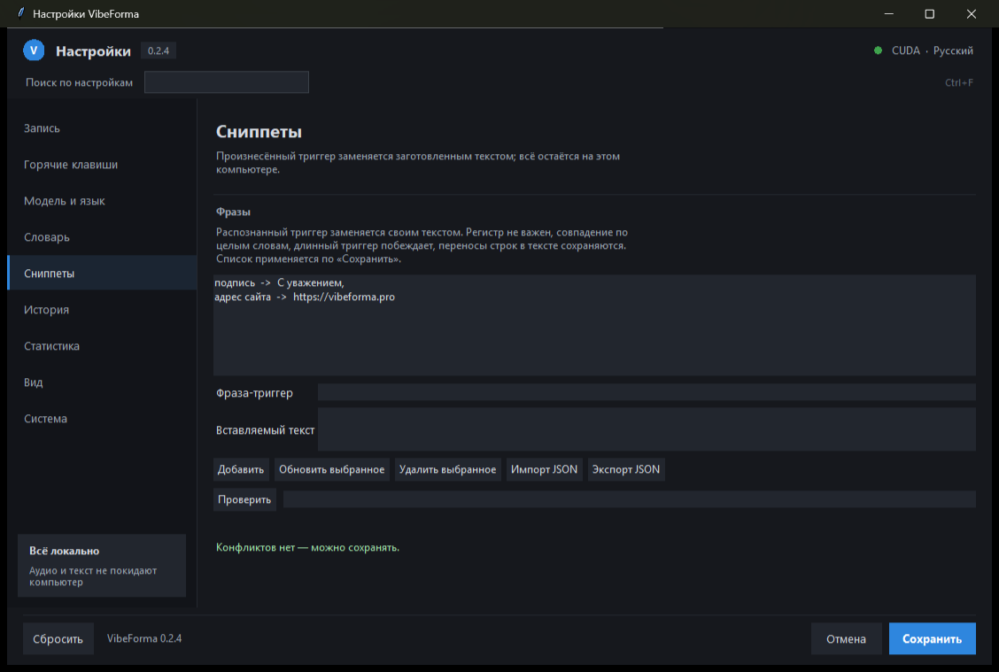

Сниппеты превращают произносимый триггер в подготовленный текст. Скажите триггер, и после распознавания VibeForma заменит его сохранённым блоком — подписью, адресом, стандартным ответом, фрагментом кода.

Сниппеты — отдельная страница и отдельный раздел настроек, потому что растут они иначе, чем словарь: сниппет — это текстовый блок, запись словаря — исправление слова.

*Настройки → Сниппеты: триггер и текст, в который он разворачивается.*
## Как работает разворачивание

1. Вы диктуете фразу с триггером.
2. Распознавание выдаёт текст.
3. VibeForma находит триггер и заменяет его подготовленным текстом.
4. Остальная часть фразы остаётся как распознана.

| Правило | Деталь |
|---|---|
| Сопоставление | Литеральное, без учёта регистра |
| Границы | Только целые слова — триггер не срабатывает внутри большего слова |
| Пересечение | Побеждает самый длинный триггер |
| Проходы | Один проход; развёрнутый текст снова не разворачивается |
| Переносы строк | Переносы в замене сохраняются |
| Лимит | До 500 пар |

Правило одного прохода не даёт сниппету развернуть самого себя через собственную замену.

## Добавление и правка сниппетов

1. Откройте **Настройки → Сниппеты**.
2. Добавьте триггер и подготовленный текст.
3. Проверьте предпросмотр: он показывает, что станет из примерной фразы.
4. Сохраните через `Ctrl+S`.

Вкладка поддерживает добавление, изменение и удаление, импорт и экспорт JSON, валидацию с подсказками. Триггер из одного частого слова вызывает предупреждение: он сработает в обычной речи, где вы этого, скорее всего, не хотели.

## Примеры

| Триггер | Подготовленный текст |
|---|---|
| `моя подпись` | `С уважением,\nАлексей` |
| `ответ в поддержку` | `Спасибо за отчёт. Воспроизвёл, пришлю исправление.` |
| `каркас html` | Многострочный каркас HTML с сохранёнными переносами |
| `мой адрес` | Полный почтовый адрес |

Триггеры должны быть фразами, которые вы не скажете случайно. `моя подпись` надёжнее, чем `подпись`; уникальная кодовая фраза — ещё надёжнее.

## Сниппеты и словарь

| Нужно | Используйте |
|---|---|
| Заменить один термин другим | [Словарь](/ru/dictionary/) |
| Вставить подготовленный блок | Сниппеты |

Пара словаря переписывает термин внутри предложения. Сниппет заменяет триггер блоком, включая переносы строк. Оба работают после распознавания, каждый за один проход.

## Импорт и экспорт

Экспорт записывает список сниппетов в JSON. Импорт добавляет файл в текущий список. Экспортируйте перед чистой переустановкой, если набрали большой набор.

## Ограничения

- Триггеры — буквальный текст, а не регулярные выражения.
- Сопоставление без учёта регистра и по целым словам.
- Выполняется только один проход, поэтому сниппет не может вызвать другой сниппет.
- Однословный триггер из частой лексики будет срабатывать слишком часто; используйте характерную фразу.
- Сниппеты применяются после распознавания; они не могут изменить то, что слышит модель.

## Что дальше

- [Словарь](/ru/dictionary/) — термины и замены.
- [Диктовка](/ru/dictation/) — полный цикл вставки.
- [Настройки](/ru/settings/) — где живут сниппеты.
- [Справочник настроек](/ru/settings-reference/) — ключи сниппетов.
