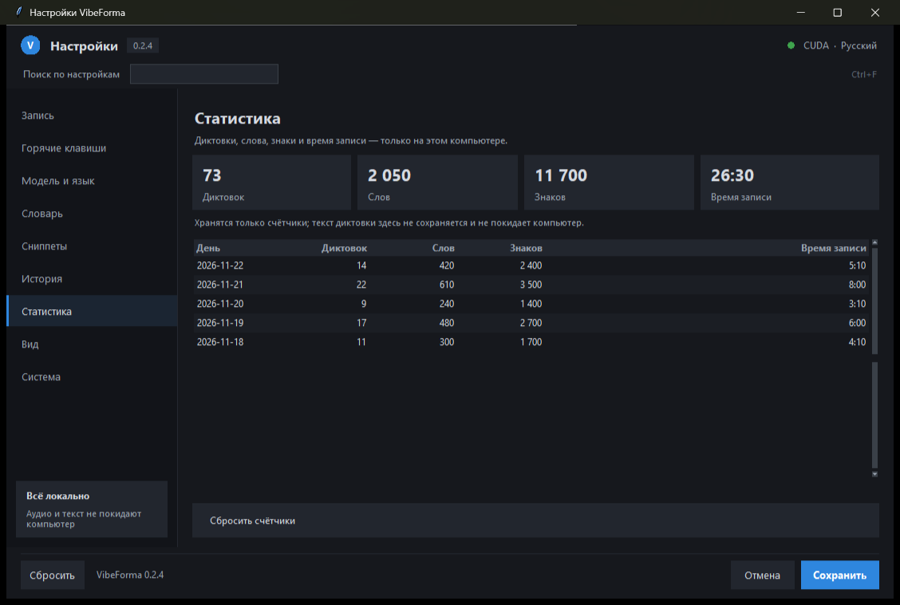

Статистика показывает, сколько вы диктуете со временем. Она локальная, не зависит от истории и хранит только числа.

*Настройки → Статистика: только счётчики, без текста.*
## Что считается

| Счётчик | Значение |
|---|---|
| Диктовки | Число завершённых диктовок |
| Слова | Число слов в распознанном тексте |
| Знаки | Число знаков |
| Секунды | Длительность записи |

Счётчики группируются по дням в `stats.json` рядом с `config.json`.

## Что не хранится

Статистика никогда не хранит текст. Ни фраз, ни слов, ни имён приложений. Только четыре счётчика за день.

Поэтому статистика работает и при выключенной истории. Она отвечает на вопрос «сколько», а не «что».

## Вкладка

**Настройки → Статистика** показывает:

- итоги за весь период;
- последние 30 дней;
- действие сброса.

Таблица заполняет панель без прокрутки страницы. Сброс спрашивает подтверждение, потому что счётчики нельзя восстановить.

## Сброс

Сброс очищает файл статистики. Он не затрагивает:

- историю;
- словарь;
- сниппеты;
- настройки.

Удаление записей истории тоже не меняет статистику. Две записи независимы по замыслу.

## Приватность

- Файл локальный: `stats.json` рядом с `config.json`.
- Записываются только числа.
- Статистика не выгружается и не входит в диагностику.
- Удаление `stats.json` сбрасывает счётчики.

## Что дальше

- [История](/ru/history/) — необязательная текстовая запись.
- [Приватность](/ru/privacy/) — полная карта данных.
- [Настройки](/ru/settings/) — раздел в контексте.
- [Файлы и расположение](/ru/files-and-paths/) — `stats.json` и соседи.
