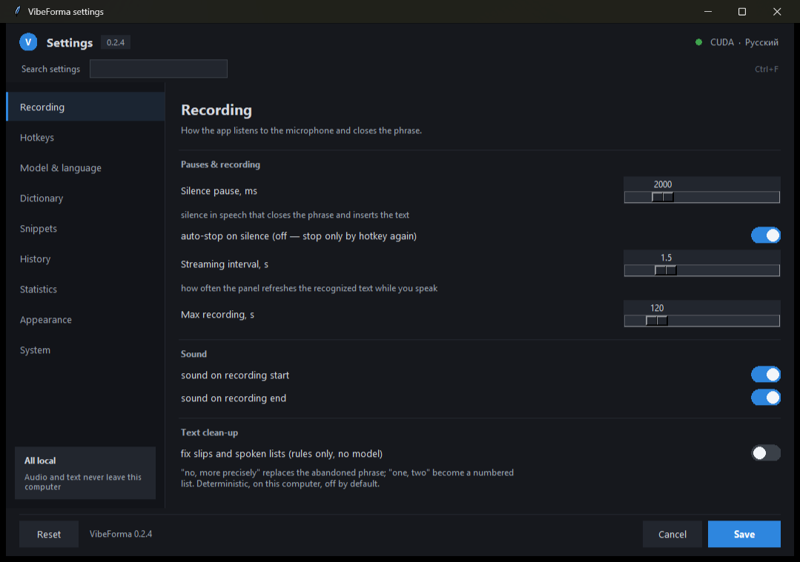

The settings window has a sidebar with nine sections. Each section has a heading and a one-line description; switches are used for on/off options, and the Save/Cancel footer stays pinned to the bottom.

Open it from the tray menu or from the panel. Changes apply to the running service without a restart.

*Settings → Recording: pauses, streaming, the phrase limit and sound.*
## The nine sections

### 1. Recording

The input device, the dictation mode and the timing of a phrase:

- microphone device;
- hold-to-talk or toggle;
- silence before a phrase ends — `silence_ms`, default 2000;
- maximum phrase length — `max_record_s`, default 120 seconds;
- partial transcription interval — `partial_every_s`, default 1.5 seconds;
- start and end beeps;
- paste method — `Shift+Insert` or `Ctrl+V`;
- clipboard restoration;
- exclusion from Windows clipboard history;
- whether notifications show the text.

### 2. Keyboard shortcuts

The editable dictation hotkey and the fixed list of every other key the app listens to. The full table is on [Keyboard shortcuts](/hotkeys/).

Changing the hotkey is protected: an invalid combination is not saved, the new listener starts before the old one stops, and a failure keeps the previous combination with a visible notification.

### 3. Model and language

- the recognition model: `large-v3`, `large-v3-turbo`, `medium`, `small`;
- the recognition language: one of 26 codes, fixed, no automatic detection;
- personal terms (`hotwords`) that always go into the recognition prompt;
- whether the previous model is kept on disk after a switch.

Changing the model opens a progress dialog with four phases: **download → load → remove → done**. If a dictation is running, the answer is "busy". A failed download rolls everything back.

### 4. Dictionary

Term → replacement pairs, up to 500, with import, export and a preview. Learning from corrections is offered here after the same correction repeats. Details: [Dictionary](/dictionary/).

### 5. Snippets

Spoken trigger → prepared text, up to 500 pairs, with import, export, preview and validation. Details: [Snippets](/snippets/).

### 6. History

The opt-in record of the last 100 dictations: the table, search, filters, selection, deletion and the switches below the table. Details: [History](/history/).

### 7. Statistics

Counters of dictations, words, characters and seconds per day, totals and the last 30 days, with a reset that asks for confirmation. Only numbers are stored. Details: [Statistics](/statistics/).

### 8. Appearance

The panel's transparency (`hud_alpha`), automatic growth (`hud_autogrow`), whether privacy mode starts enabled (`hud_privacy`), and showing or hiding the panel. Details: [Panel, tray and autostart](/interface/).

### 9. System

Autostart, update checks and their interval, the manual **Check now** action, the local HTTP API switch and port, the logs folder, diagnostics, and the application version.

## Window behavior

| Behavior | Detail |
|---|---|
| Search | `Ctrl+F` focuses the search field |
| Save | `Ctrl+S` saves without closing the window; confirmation appears in place |
| Close | `Esc` closes the window |
| Reset | Restores default settings; the model, dictionary and history are kept |
| Geometry | The window is sized once from the tallest tab, limited to the screen and centered |
| Scrolling | Each tab scrolls with a dark scrollbar when needed |
| Tables | History and statistics fill the panel without scrolling the page |
| DPI | Window and panel sizes scale with the display DPI factor, so 150% scaling stays readable |
| Corners | Rounded corners and a dark title bar through DWM |

## What applies live

These changes reach the running service immediately:

- silence duration;
- streaming interval;
- maximum recording length;
- panel transparency and autogrow;
- beeps;
- hotkey;
- input device;
- autostart;
- paste method.

Changes that need to load or remove a model (switching models) run through the progress dialog and are not instant.

## Reset

**Reset** returns the settings to their defaults. It does not delete:

- the selected model;
- the dictionary;
- the history.

Statistics reset is a separate action on the Statistics tab and asks for confirmation.

## Where to go next

- [Settings reference](/settings-reference/) — every setting, its key and its default.
- [Models and languages](/models/) — choosing a model.
- [Dictation](/dictation/) — the effect of the recording options.
- [Files and locations](/files-and-paths/) — where settings are stored.
