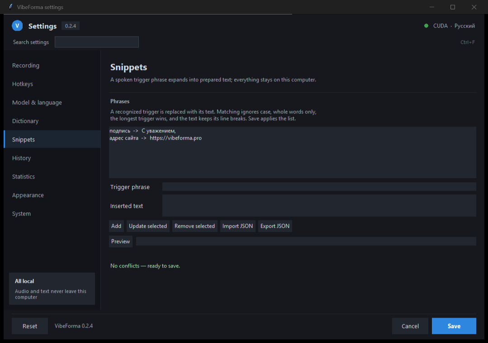

Snippets turn a spoken trigger into prepared text. Say the trigger, and after recognition VibeForma replaces it with the stored block — a signature, an address, a standard reply, a code fragment.

Snippets are a separate page and a separate settings section because they grow differently from the dictionary: a snippet is a text block, a dictionary entry is a word correction.

*Settings → Snippets: a spoken trigger and the text it expands to.*
## How expansion works

1. You dictate a phrase containing the trigger.
2. Recognition produces the text.
3. VibeForma finds the trigger and replaces it with the prepared text.
4. The rest of the phrase stays as recognized.

| Rule | Detail |
|---|---|
| Matching | Literal, case-insensitive |
| Boundaries | Whole words only — the trigger does not match inside a larger word |
| Overlap | The longest trigger wins |
| Passes | One pass; expanded text is not expanded again |
| Line breaks | Newlines in the replacement are preserved |
| Limit | Up to 500 pairs |

The one-pass rule prevents a snippet from expanding itself through its own replacement.

## Add and edit snippets

1. Open **Settings → Snippets**.
2. Add a trigger and the prepared text.
3. Check the preview: it shows what a sample phrase becomes.
4. Save with `Ctrl+S`.

The tab supports add, update and remove, import and export as JSON, and validation with hints. A trigger that is a single common word produces a warning: it will fire in ordinary speech, where you probably did not mean it.

## Examples

| Trigger | Prepared text |
|---|---|
| `my signature` | `Best regards,\nAlex` |
| `support reply` | `Thanks for the report. I can reproduce it and will send a fix.` |
| `html skeleton` | A multi-line HTML skeleton with preserved newlines |
| `my address` | The full postal address |

Triggers should be phrases you would not say by accident. `my signature` is safer than `signature`; a unique code phrase is safer still.

## Snippets and the dictionary

| Need | Use |
|---|---|
| Replace one term with another | [Dictionary](/dictionary/) |
| Insert a prepared block | Snippets |

A dictionary pair rewrites a term inside the sentence. A snippet replaces a trigger with a block, including line breaks. Both run after recognition, in one pass each.

## Import and export

Export writes the snippet list as JSON. Import merges a file into the current list. Export before a clean reinstall if you have built a large set.

## Limitations

- Triggers are literal text, not regular expressions.
- Matching is case-insensitive and whole-word.
- Only one pass runs, so a snippet cannot trigger another snippet.
- A one-word trigger from common vocabulary will fire too often; use a distinctive phrase.
- Snippets are applied after recognition; they cannot change what the model hears.

## Where to go next

- [Dictionary](/dictionary/) — terms and replacements.
- [Dictation](/dictation/) — the full insertion loop.
- [Settings](/settings/) — where snippets live.
- [Settings reference](/settings-reference/) — the snippet keys.
