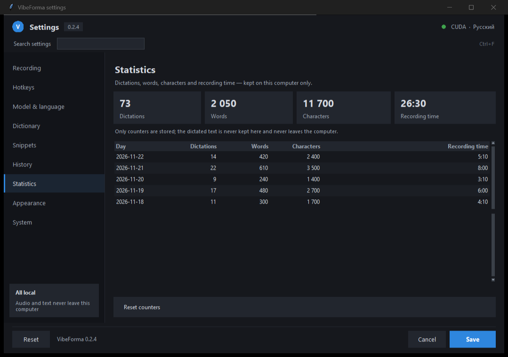

Statistics show how much you dictate over time. They are local, independent of history, and store only numbers.

*Settings → Statistics: counters only, no text.*
## What is counted

| Counter | Meaning |
|---|---|
| Dictations | The number of finished dictations |
| Words | The number of words in recognized text |
| Characters | The number of characters |
| Seconds | The recorded duration |

Counters are grouped per day in `stats.json` next to `config.json`.

## What is not stored

Statistics never store text. No phrases, no words, no application names. Only four counters per day.

That is why statistics keep working when history is off. They answer "how much", not "what".

## The tab

**Settings → Statistics** shows:

- totals over the whole period;
- the last 30 days;
- a reset action.

The table fills the panel without scrolling the page. The reset asks for confirmation, because counters cannot be reconstructed.

## Reset

Reset clears the statistics file. It does not touch:

- history;
- the dictionary;
- snippets;
- settings.

Deleting history records does not change statistics either. The two records are independent by design.

## Privacy

- The file is local: `stats.json` next to `config.json`.
- Only numbers are written.
- Statistics are not uploaded and not included in diagnostics.
- Deleting `stats.json` resets the counters.

## Where to go next

- [History](/history/) — the optional text record.
- [Privacy](/privacy/) — the full data map.
- [Settings](/settings/) — the section in context.
- [Files and locations](/files-and-paths/) — `stats.json` and its neighbours.
